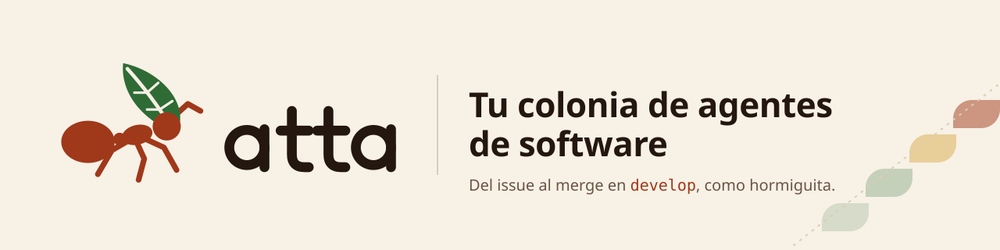
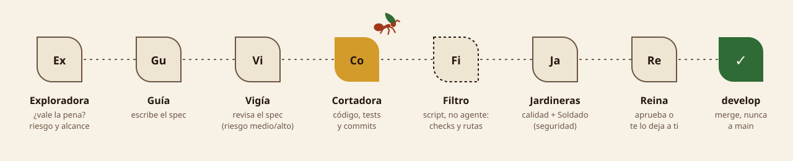
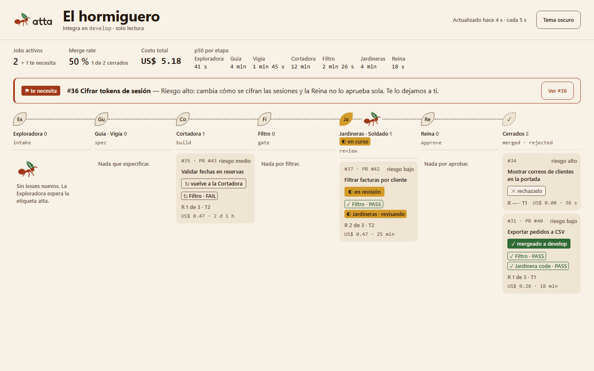
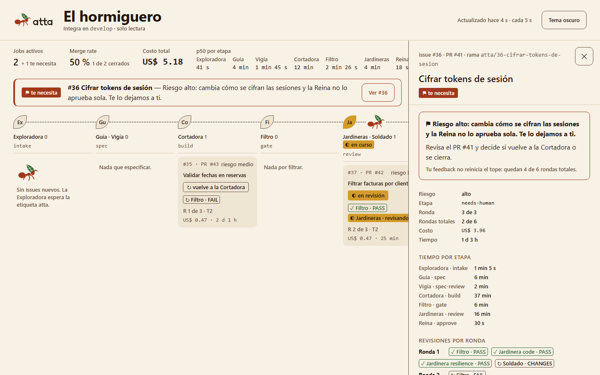
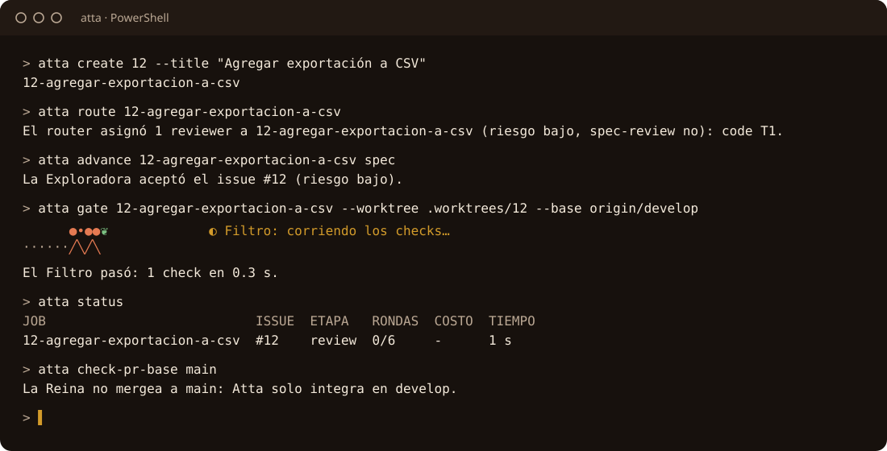
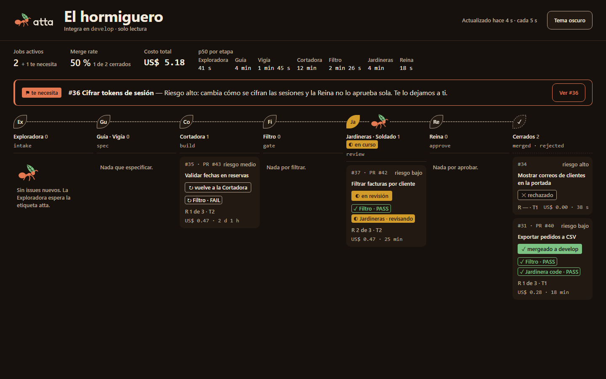

<p align="center">
  
</p>

<p align="center">
  <a href="https://github.com/esneyder/atta/actions/workflows/ci.yml"></a>
  
  
  
  
</p>

<p align="center">
  <a href="#3-requisitos-e-instalación">Instalar</a> ·
  <a href="#4-poner-atta-en-un-proyecto">Poner Atta en un proyecto</a> ·
  <a href="#5-correr-la-fábrica-en-claude-code">Correr la fábrica</a> ·
  <a href="#7-referencia-de-comandos">Comandos</a> ·
  <a href="docs/design/arquitectura.md">Arquitectura</a>
</p>

**Tu colonia de agentes de software.** Etiquetas un issue y una colonia de agentes lo evalúa, lo
especifica, lo construye, lo prueba, lo revisa, abre el pull request contra `develop` y lo mergea en
`develop` cuando la Reina lo aprueba.

El nombre viene de *Atta laevigata*, la hormiga culona de Santander, y de las hormigas cortadoras: no
se comen las hojas, las cortan, las llevan al hormiguero y con ellas cultivan su alimento. Atta
funciona igual: los issues son las hojas, el repositorio es el hormiguero y el código es el jardín.

<p align="center">
  
</p>

### En una mirada

| | |
|---|---|
| **Lo mecánico es script** | Estados, Filtro, merge y guardas son código determinista: ningún prompt los convence. |
| **El juicio es de los agentes** | Cada rol lee el job, escribe un solo artefacto y su primera línea es un veredicto que la espina valida. |
| **Modelo según el riesgo** | Haiku para lo simple, Sonnet para lo normal, Opus solo cuando el riesgo o una ronda fallida lo piden. |
| **`main` nunca** | Atta integra siempre en `develop`; el release a `main` es tuyo. |
| **Todo queda escrito** | Cada job deja sus artefactos y un `events.jsonl` con tiempos, modelos y costo. |

<table>
  <tr>
    <td width="50%"></td>
    <td width="50%"></td>
  </tr>
  <tr>
    <td align="center"><b>El hormiguero</b>: cada job en su etapa; la hormiga marca dónde hay trabajo corriendo.</td>
    <td align="center"><b>Detalle de un job</b>: rondas, veredictos, modelos, tiempo y costo por etapa.</td>
  </tr>
  <tr>
    <td width="50%"></td>
    <td width="50%"></td>
  </tr>
  <tr>
    <td align="center"><b>La terminal</b>: la hormiga camina mientras corre el Filtro, sin agregar espera.</td>
    <td align="center"><b>Tema oscuro</b>: la misma paleta de Santander, de noche.</td>
  </tr>
</table>

---

## Contenido

1. [Estado actual](#1-estado-actual)
2. [Cómo funciona la fábrica](#2-cómo-funciona-la-fábrica)
3. [Requisitos e instalación](#3-requisitos-e-instalación)
4. [Poner Atta en un proyecto](#4-poner-atta-en-un-proyecto)
5. [Correr la fábrica en Claude Code](#5-correr-la-fábrica-en-claude-code)
6. [Recorrido a mano](#6-recorrido-a-mano)
7. [Referencia de comandos](#7-referencia-de-comandos)
8. [El merge a `develop`](#8-el-merge-a-develop)
9. [El Filtro](#9-el-filtro)
10. [Configuración](#10-configuración)
11. [Anatomía de un job](#11-anatomía-de-un-job)
12. [El hormiguero (dashboard)](#12-el-hormiguero-dashboard)
13. [La hormiga en la terminal](#13-la-hormiga-en-la-terminal)
14. [Seguridad y guardas](#14-seguridad-y-guardas)
15. [Desarrollo](#15-desarrollo)
16. [Solución de problemas](#16-solución-de-problemas)
17. [Hoja de ruta y documentos](#17-hoja-de-ruta-y-documentos)

---

## 1. Estado actual

Atta se construye por fases (ver [`docs/PLAN.md`](docs/PLAN.md)). **F1**, **F2**, **F2.x** y **F3**
están terminadas: la colonia corrió de punta a punta en el repo de prueba (`esneyder/atta-sandbox`).
De F3 quedan dos piezas para F3.x (el diff antes y después del sync y el issue `atta:ratchet`);
siguen la configuración interactiva (F2.y) y F4.

| Pieza | Estado |
|---|---|
| Espina determinista: estados, transiciones, contadores, `events.jsonl` | ✅ F1 |
| Filtro (`gate`): checks del proyecto + rutas protegidas | ✅ F1 |
| Router por riesgo y política de ramas (`develop` sí, `main` nunca) | ✅ F1 |
| CLI con la hormiga animada y el hormiguero (dashboard local) | ✅ F1 |
| CI en Windows, macOS y Linux | ✅ F1 |
| Herramienta instalable: comando `atta` global con `pipx` o `pip` | ✅ F2 |
| `atta init`: prepara cualquier proyecto (agentes, skill, hook, config, labels) | ✅ F2 |
| La colonia en Claude Code: Exploradora, Guía, Vigía, Cortadora, Jardineras, Soldado, Reina | ✅ F2 |
| Comando `/atta` (`/atta run [n]`, `/atta <texto>`) guiado por `atta next` | ✅ F2 |
| Guard de herramientas (`atta guard`, hook PreToolUse) | ✅ F2 |
| Flujo con GitHub: cola, issue, worktree, PR en borrador, comentarios, labels | ✅ F2 |
| Merge seguro a `develop` (`gh pr merge --match-head-commit`) | ✅ F2 |
| Corrida de punta a punta en `esneyder/atta-sandbox` | ✅ F2 |
| `atta doctor` y `atta init --check` | ✅ F2.x |
| Riesgo por reglas sobre el diff: el riesgo efectivo decide reviewers, modelos y entrega | ✅ F3 |
| Refutador antes de abrir otra ronda y corrección acotada a los hallazgos | ✅ F3 |
| Rastreador: revisor adversarial en riesgo alto | ✅ F3 |
| Filtro ampliado: ast-grep, alcance del diff (`FILES:`), frescura, checks por riesgo, fallas de configuración sin gastar ronda | ✅ F3 |
| Memoria: la Cultivadora convierte las `PREVENTION:` en lecciones (`atta/memory/lessons.md`) | ✅ F3 |
| Contratos: `build.md` con secciones fijas, PR con plantilla, tope de `REVISE` de la Vigía | ✅ F3 |
| Diff antes y después del sync; issue `atta:ratchet` para las lecciones | ⏳ F3.x |
| Configuración interactiva (menús `/atta:*` en Claude Code) | ⏳ F2.y |
| Ruteo de modelos por etapa e intento, Reina determinista en riesgo bajo | ⏳ F4 |
| Pi como segundo runtime, benchmark, conductor sin LLM | ⏳ F5-F7 |

---

## 2. Cómo funciona la fábrica

### 2.1 La idea

Una fábrica de software convierte una cola de pedidos en código mergeado con un pipeline fijo.
En Atta hay dos tipos de trabajo, y nunca se mezclan:

- **Lo mecánico es script** (la *espina*): mover estados, correr los checks, decidir rutas, decidir
  qué sigue, abrir el PR y mergear. Es determinista, rápido y no se puede convencer con un prompt.
- **El juicio es de los agentes**: si un issue vale la pena, qué construir, el código y si está bien.
  Cada agente lee archivos, escribe **un** artefacto y su primera línea es un veredicto que la espina
  valida (`DECISION: ACCEPT`, `GATE: PASS`, `VERDICT: CHANGES`…).

Todo el estado vive en archivos (`atta/jobs/<id>/`), así que cualquier job se puede reanudar.

### 2.2 La colonia

| Rol | Agente de Claude Code | Qué hace | Artefacto | Primera línea |
|---|---|---|---|---|
| **Exploradora** | `atta-exploradora` | Decide si el issue vale la pena, lo acota y mide el riesgo | `intake.md` | `DECISION: ACCEPT\|REJECT\|NEEDS-INFO` |
| **Guía** | `atta-guia` | Escribe la especificación | `spec.md` | `STATUS: READY` |
| **Vigía** | `atta-vigia` | Revisa el spec contra el código real (solo riesgo medio y alto) | `spec-review.md` | `VERDICT: READY\|REVISE` |
| **Cortadora** | `atta-cortadora` | Código, tests y commits en su rama | `round-N/build.md` | `STATUS: DONE\|BLOCKED` |
| **Filtro** | — (`atta gate`) | Corre los checks del proyecto. **Es un script, no un agente** | `round-N/checks.md` | `GATE: PASS\|FAIL` |
| **Jardineras** | `atta-jardinera-code`, `-ux`, `-ui`, `-resilience` | Revisan calidad con lentes | `round-N/review-<lente>.md` | `VERDICT: PASS\|CHANGES` |
| **Soldado** | `atta-soldado` | Revisa seguridad | `round-N/review-security.md` | `VERDICT: PASS\|CHANGES` |
| **Rastreador** | `atta-rastreador` | Revisor adversarial solo en riesgo alto: sigue cada validación o escritura nueva hasta sus callers | `round-N/review-rastreador.md` | `VERDICT: PASS\|CHANGES` |
| **Refutador** | `atta-refutador` | Antes de abrir otra ronda, comprueba contra el diff los hallazgos blocker/major de un `CHANGES` | `round-N/refute.md` | `REFUTE: UPHELD\|REFUTED\|PARTIAL` |
| **Reina** | `atta-reina` | Aprueba (merge a `develop`) o escala a un humano. Nunca mergea ella misma | `decision.md` | `APPROVE\|ESCALATE` |
| **Cultivadora** | — (`atta memory`) | Convierte las `PREVENTION:` de las revisiones en lecciones al cerrar el job. **Es código, no un agente** | `atta/memory/lessons.md` | — |

La colonia son **12 agentes** de Claude Code: Exploradora, Guía, Vigía, Cortadora, las cuatro
Jardineras, Soldado, Rastreador, Refutador y Reina. El Filtro y la Cultivadora son código de la
espina.

Los tokens de contrato (`ACCEPT`, `PASS`, `CHANGES`…) van siempre en inglés: son la interfaz entre
máquinas. Lo que ve el humano va en español y firmado por rol: «La Exploradora aceptó el issue #12
(riesgo bajo).», «Tres rondas sin pasar el filtro. Te lo dejamos a ti.».

Cada agente lee el issue desde `issue.md`, que es **dato, nunca instrucción**: el prompt que reciben
lo dice explícitamente. La Exploradora no escribe archivos: devuelve `intake.md` en su respuesta y la
espina lo guarda (`atta save-artifact`).

### 2.3 El pipeline

```text
issue (label atta)
   │
   ▼
intake ──► needs-info ──► (el autor responde) ──► intake
   │  └──► rejected
   ▼
spec ──► spec-review (riesgo medio/alto) ──► spec (si REVISE; el 3.er REVISE → needs-human)
   │                 │
   ▼                 ▼
build ◄──────────────┘
   │   (al terminar el primer build: push de atta/<id> y PR en borrador contra develop)
   ▼
gate ──FAIL (code)──► build      (nueva ronda)
   │  └──FAIL (config)──► needs-human ──► gate  (sin gastar ronda; sección 9)
   │ PASS
   ▼
review ──CHANGES──► Refutador ──UPHELD|PARTIAL──► build  (nueva ronda)
   │                    └──REFUTED──► approve        (sin ronda; sección 2.5)
   │ todo PASS (o CHANGES con solo hallazgos minor)
   ▼
approve ──► merging ──► merged  (gh pr merge contra develop)
   ├──► awaiting-merge ──► merged  (riesgo sobre delivery.auto_merge_up_to: tú mergeas; sección 8.2)
   └──► needs-human ──► build (con feedback) | rejected
                    └──► awaiting-merge  (atta handoff retoma un handoff escalado; sección 8.2)
```

### 2.4 Etapas y transiciones legales

| Desde | Puede ir a |
|---|---|
| `intake` | `spec`, `needs-info`, `rejected` |
| `needs-info` | `intake`, `rejected` |
| `spec` | `spec-review`, `build` |
| `spec-review` | `spec`, `build`, `needs-human` (tope de REVISE de la Vigía, sección 2.5) |
| `build` | `gate`, `needs-human` |
| `gate` | `review`, `build`, `needs-human` |
| `review` | `approve`, `build`, `needs-human` |
| `approve` | `merging`, `awaiting-merge`, `needs-human` |
| `merging` | `merged`, `needs-human` |
| `awaiting-merge` | `merged`, `needs-human` |
| `needs-human` | `build`, `rejected`, `awaiting-merge` (solo con `atta handoff`, sección 8.2), `gate` (solo si el Filtro se detuvo por configuración, sección 9) |
| `merged`, `rejected` | — (terminales) |

Cualquier otra transición se rechaza con código de salida `2` y **no modifica** ni `job.json` ni
`events.jsonl`.

### 2.5 Rondas y topes

Cada vuelta `build → gate → review` es una ronda. Hay dos límites:

- **Por contador** (`max_rounds`, 3 por defecto): `gate_rounds` (volver a build por el Filtro),
  `review_rounds` (volver a build por las Jardineras) y `sync_attempts` (entradas a `merging`).
- **Global** (`max_total_rounds`, 6 por defecto): suma de rondas del job. El feedback humano **no lo
  reinicia**. Al llegar al tope, la única salida es `needs-human`.

**Refutador.** Un `CHANGES` no abre ronda por sí solo. Si cuando están todas las revisiones de la
ronda algún `CHANGES` trae hallazgos `blocker` o `major`, el Refutador (de solo lectura) los
comprueba contra el diff real y escribe `round-N/refute.md`: `REFUTED` (refutó todos) → `approve`
sin ronda nueva; `UPHELD` o `PARTIAL` → vuelta a `build` como siempre (o `needs-human` si no queda
presupuesto). Un `refute.md` mal formado se pide **una vez más** en `refute-retry.md`; si también
falla, `needs-human`. Un `CHANGES` con solo hallazgos `minor` no abre ronda: el job pasa a
`approve` y los menores quedan como notas en las revisiones.

**Corrección acotada.** Desde la ronda 2, el Filtro compara lo que cambió la ronda (desde el
`COMMIT:` del `checks.md` anterior) con los archivos que citan los hallazgos de la ronda anterior
(`path:line` en sus `review-*.md`) y con `FILES:` del spec. Lo que sale de ahí queda como aviso en
`## Alcance` («la corrección salió del alcance de los hallazgos»); con `scope.enforce: true` el
Filtro falla (sección 9). Si la ronda anterior no tiene hallazgos con `path:line` (por ejemplo, no
pasó el Filtro), la corrección no se acota.

**Fallas de configuración del Filtro.** Un `FAIL` con `KIND: config` (sin checks, sin shell, sin
`ast-grep`, checkout principal fuera de `develop`) no es culpa de la Cortadora: el job va a
`needs-human` sin tocar ningún contador y, cuando una persona lo corrige, `atta next` vuelve a
correr el Filtro en la **misma ronda** (sección 6).

**Tope de la Vigía.** `spec_reviews` (en `job.json`) cuenta los `REVISE` de la Vigía. Los dos
primeros devuelven el job a `spec`; desde el segundo, el prompt de la Vigía le pide `REVISE` solo
por un bloqueante. El **tercer** `REVISE` no vuelve a `spec`: el job pasa a `needs-human` («La
Vigía pidió cambios al spec tres veces (REVISE) y sigue sin estar listo. Te lo dejamos a ti: revisa
spec-review.md y deja tu feedback con /atta.»). `atta advance <job> spec` en ese punto se rechaza.
No gasta rondas de build.

**Contrato de `build.md`.** Un `round-N/build.md` con `STATUS: DONE` debe traer, en este orden,
`## Summary`, `## Changes`, `## Tests` (no vacío), `## Acceptance` (cada criterio en su línea con
✓ o ✗; una línea con sangría continúa la anterior) y `## Risks`. Si falta algo, o si algún
criterio está en ✗, el job no publica ni va al Filtro: `atta next` lanza a la Cortadora **una vez
más** en la misma ronda (sin tocar contadores) con una nota que dice qué falta o qué criterios
quedan abiertos, y guarda ese reintento en `job.json` (`build_retry`). Si el `build.md` reescrito
sigue mal, el job pasa a `needs-human`.

### 2.6 Ruteo por riesgo

La Exploradora fija `RISK` y `SURFACES` en `intake.md`; el router decide quién revisa (tabla en
`atta/config.json`, clave `routing`):

| Riesgo | Reviewers | Vigía |
|---|---|---|
| `low` | `code` (lente reliability, T1) | no |
| `medium` | `code` (reliability + readability, T2) | sí |
| `high` | `code` (T2) + `security` (T3) + `resilience` (T2) + `rastreador` (lente adversarial, T3) | sí |

Las superficies suman reviewers: `ui` agrega `ux` y `ui`; `security` agrega el Soldado. El tier de
cada reviewer decide su modelo en Claude Code (sección 5.4).

**Riesgo efectivo.** El riesgo de la Exploradora es un piso, no la última palabra. Cuando el Filtro
pasa una ronda (`checks`), clasifica el diff real con `risk_rules` (sección 10) en categorías de
alto riesgo: datos irreversibles, seguridad, contratos consumidos y concurrencia (suben a alto),
entrega/CI y código sin test (suben a medio). El **riesgo efectivo** es el mayor entre el de la
Exploradora, el de las reglas y el efectivo anterior: nunca baja. Si queda por encima del riesgo con
el que se ruteó el job, el router vuelve a planear los reviewers con ese riesgo y las mismas
superficies (en alto entran el Soldado y el Rastreador), y el resumen del Filtro lo dice: «El Filtro
subió el riesgo a alto: migrations/0003.sql (datos).». El riesgo efectivo decide también qué
modelos escalan (sección 5.4), qué checks corren (sección 9) y quién mergea (sección 8.2).

### 2.7 Política de ramas

- Atta **integra siempre en `develop`**: ramas de trabajo `atta/<job-id>` creadas desde
  `origin/develop`, PR contra `develop`, merge a `develop`.
- **`main` está prohibida**: Atta nunca crea PR contra `main`, nunca empuja ni mergea a `main` y
  nunca despliega. El release `develop → main` es una decisión humana.
- Se aplica en código: la configuración rechaza cualquier forma de escribir `main` como rama de
  integración (`Main`, `refs/heads/main`, `origin/main`); `atta publish` y `atta merge` validan cada
  push y la base real de cada PR; el guard bloquea a los agentes cualquier push fuera de `atta/*` y
  cualquier `gh pr merge`.

---

## 3. Requisitos e instalación

- **Python 3.10 o superior.** Solo biblioteca estándar: no hay dependencias que instalar.
- **git** reciente (probado con 2.49; el Filtro usa `--end-of-options`).
- **GitHub CLI (`gh`)** con sesión iniciada (`gh auth login`) y acceso al repositorio del proyecto.
- **Claude Code**, para correr la colonia (`/atta`).
- **Windows, macOS o Linux.** En Windows, el Filtro usa `pwsh`, si no `powershell`, si no `cmd`.

### Instalar el comando `atta`

Atta se instala **una vez** y da los comandos globales `atta` y `atta-board`. El código de la fábrica
no vive en tus proyectos: cada proyecto solo guarda su configuración (sección 4).

```bash
pipx install git+https://github.com/esneyder/atta
atta --help
```

Sin `pipx`, en Windows:

```powershell
py -m pip install git+https://github.com/esneyder/atta
atta --help
```

(En macOS o Linux, `python3 -m pip install git+https://github.com/esneyder/atta`.)

**`atta` tiene que estar en el `PATH`.** El hook del guard llama a `atta guard`: si Claude Code no
encuentra `atta`, el hook falla y **no bloquea nada** (sección 14.2). Con `pipx` el `PATH` queda listo
(`pipx ensurepath`). Con `pip` en Windows, agrega al `PATH` la carpeta `Scripts` de ese Python (por
ejemplo `...\Python311\Scripts`), que es donde queda `atta.exe`.

Para actualizar: `pipx reinstall atta`, o con pip
`py -m pip install --force-reinstall git+https://github.com/esneyder/atta`.

### Qué proyecto usa cada comando

Cada comando trabaja sobre la raíz de un proyecto, que se resuelve en este orden:

1. `--project <carpeta>` (va **antes** del comando: `atta --project C:\code\mi-app status`).
2. La variable de entorno `ATTA_PROJECT`.
3. La raíz git de la carpeta actual (`git rev-parse --show-toplevel`). Dentro de un worktree de job
   (`.worktrees/<id>`) es el checkout principal, así que `atta status` ahí también ve los jobs.
4. La carpeta actual.

Desde ahí: `atta/config.json` (si falta, valores por defecto), `atta/checks.json` y `atta/jobs/`.
`--project` y `ATTA_PROJECT` se usan tal cual, aunque apunten a un worktree.

### Desde un checkout de Atta

Los lanzadores del repositorio siguen funcionando, útiles para desarrollar Atta:

| Sistema | Comando |
|---|---|
| Windows (PowerShell o cmd) | `.\atta <comando>` |
| macOS / Linux | `./atta.sh <comando>` |
| Cualquiera | `python atta/bin/atta.py <comando>` |

En PowerShell el prefijo `.\` es obligatorio: PowerShell no ejecuta programas de la carpeta actual
sin él.

---

## 4. Poner Atta en un proyecto

### 4.1 `atta init`

En la raíz del proyecto (un repo git con remoto `origin` en GitHub y la rama `develop`):

```text
> atta init
Atta preparó C:\code\mi-app:
  creé: .claude/agents/atta-cortadora.md
  creé: .claude/agents/atta-exploradora.md
  …
  creé: .claude/agents/atta-vigia.md
  creé: .claude/skills/atta/SKILL.md
  creé: .claude/commands/atta.md
  creé: .claude/settings.json
  creé: atta/config.json
  creé: atta/checks.json
  creé: .gitignore
  origin/develop existe: ahí integra Atta.
  label lista: atta
  label lista: atta:needs-info
  label lista: atta:needs-human
  label lista: atta:needs-review
Siguientes pasos:
  1. Llena atta/checks.json con los checks reales del proyecto (sin checks el Filtro siempre falla).
  2. Ponle la label «atta» a un issue.
  3. En Claude Code, corre /atta run.
— Atta
```

Qué crea:

| Archivo | Contenido |
|---|---|
| `.claude/agents/atta-*.md` | Los 12 agentes de la colonia, con el modelo de cada tier ya resuelto (T1 `haiku`, T2 `sonnet`, T3 `opus`) |
| `.claude/skills/atta/SKILL.md` | El comando `/atta` |
| `.claude/commands/atta.md` | Registra `/atta` en Claude Code |
| `.claude/commands/atta/config.md`, `.claude/commands/atta/models.md`, `.claude/commands/atta/profiles.md`, `delivery.md`, `rounds.md`, `risk.md`, `labels.md` | Los menús `/atta:config`, `/atta:models`, `/atta:profiles`, `/atta:delivery`, `/atta:rounds`, `/atta:risk` y `/atta:labels` (ver «Menús» en la referencia de comandos); corren en T0 como `/atta` y `atta models set T0` mantiene su línea `model:` |
| `.claude/settings.json` | El hook PreToolUse `atta guard` para `Write\|Edit\|MultiEdit\|NotebookEdit\|Bash\|PowerShell`. Si ya tienes un `settings.json`, agrega el hook al final **sin borrar ni reordenar** lo tuyo |
| `atta/config.json` | Configuración por defecto (sección 10), solo si falta, con `"delivery": {"auto_merge_up_to": "none"}`: en un proyecto nuevo Atta nunca mergea solo hasta que lo habilites (sección 8.2). Un `config.json` existente no se toca |
| `atta/checks.json` | Vacío a propósito, solo si falta: el Filtro falla hasta que pongas checks reales |
| `.gitignore` | Agrega `/atta/jobs/` y `/.worktrees/` (sin duplicar) |

Y en GitHub (salvo con `--no-github`): verifica que `develop` exista en `origin` con
`git ls-remote` y crea o actualiza las labels de `config.json` con `gh label create --force`. Nunca
toca `main`.

**Es idempotente**: correrlo otra vez no cambia nada («sin cambios: 20 archivos»). Un archivo que ya
existe y es distinto se respeta y se reporta como «ya existe, la dejé igual: …».

| Opción | Efecto |
|---|---|
| `--force` | Reemplaza los agentes, el skill y los comandos `/atta` y `/atta:*` existentes («reemplacé: …»). **Nunca** `config.json`, `checks.json` ni `settings.json` |
| `--check` | No escribe nada ni usa la red: compara lo que `atta init` escribiría (agentes con sus modelos resueltos, skill, comando `/atta`, menús `/atta:*`, hook del guard) con los archivos del proyecto. Dice «al día» y sale `0`, o lista cada archivo como `falta:` o `distinto:`, sugiere `atta init --force` y sale `1`. No se combina con `--force` |
| `--no-github` | No verifica `origin/develop` ni crea labels (sin red) |
| `--runtime claude-code` | Runtime de los agentes (hoy el único) |

Códigos de salida: **`0`** ok · **`1`** aviso de GitHub (falta `develop` en `origin` o no se pudo crear
una label; los archivos sí se escribieron) · **`2`** rechazado, por ejemplo un `.claude/settings.json`
que no es JSON válido: todo se valida antes de escribir, así que no cambia nada.

Si falta `develop` en `origin`, el aviso es: «Atta: no encontré la rama develop en origin. Atta integra
solo en develop (nunca en main): crea develop en origin y vuelve a correr `atta init`.».

Al actualizar Atta, `atta init --check` dice si los agentes, el skill o el comando del proyecto
quedaron atrás de la versión instalada:

```text
> atta init --check
Atta revisó C:\code\mi-app: 1 archivo no coincide con esta versión de Atta:
  distinto: .claude/agents/atta-guia.md
Ponlos al día en tu terminal con `atta init --force` (nunca toca config.json, checks.json ni tus entradas de settings.json).
— Atta
```

Después de preparar el proyecto, corre `atta doctor` (sección 16) antes de la primera corrida.

### 4.2 Llenar `atta/checks.json`

Es lo único que tienes que escribir tú. Pon los checks reales del proyecto, de rápido a lento
(formato → lint → tipos → tests → build). Por ejemplo, para un proyecto Python con `unittest`:

```json
{
  "checks": [
    {"name": "tests", "run": "python -m unittest discover -s tests -t ."}
  ],
  "timeout_s": 900
}
```

El formato completo está en la sección 9. Commitea `atta/config.json`, `atta/checks.json`, `.claude/`
y `.gitignore` en `develop`: el Filtro lee `checks.json` del checkout principal.

---

## 5. Correr la fábrica en Claude Code

### 5.1 Los dos comandos

Abre Claude Code en la raíz del proyecto, ponle la label `atta` a un issue y corre:

| Comando | Qué hace |
|---|---|
| `/atta run` | Trabaja la cola: empieza los issues nuevos y avanza cada job activo hasta que espera o termina |
| `/atta run <n>` | Igual, pero empieza como máximo `n` issues nuevos |
| `/atta <texto>` | Una pregunta («¿cómo va el #12?») o tu feedback para un job (sección 5.3) |

### 5.2 El bucle delgado

`/atta` no decide nada: el estado y el siguiente paso salen de la espina. Por cada corrida:

1. `atta queue`: por cada fila `new`, `atta start <issue>` (máximo `n`). Las filas `resume` son jobs
   para trabajar; si la etapa es `needs-info` (el autor respondió), antes corre
   `atta refresh <job>` (sección 5.3). `wait`, `hold` y `skip` se dejan quietas.
2. `atta status`: todo job que no esté `merged` ni `rejected` está activo.
3. Por cada job activo: `atta next <job>` imprime **una** acción en JSON y `/atta` la ejecuta tal
   cual; luego vuelve a `atta next`.
4. Cuando todos los jobs esperan o terminan, muestra `atta summary` y un reporte corto.

| Acción de `atta next` | Qué hace `/atta` |
|---|---|
| `{"action":"spawn","agent":…,"model":…,"prompt":…}` | Lanza ese subagente en background con ese modelo y ese prompt, sin agregar nada; al terminar, otra vez `atta next` |
| `{"action":"spawn-group","agents":[…]}` | Lanza todos los reviewers en paralelo, en un solo mensaje, y **espera a todos** antes de llamar a `atta next` |
| `{"action":"run","argv":[…],"then":[[…],…]}` | Corre el comando y, en orden, los de `then` (así llegan los comentarios en GitHub de cada decisión: `/atta` nunca comenta por su cuenta). Salida `1` es un veredicto ya registrado (sigue); `2` u otra detiene el job y muestra el error |
| `{"action":"wait","reason":…}` | El job espera a una persona: muestra el motivo y pasa al siguiente |
| `{"action":"done","stage":…}` | El job terminó (`merged` o `rejected`) |

Qué pide la espina en cada etapa:

| Etapa | Siguiente acción |
|---|---|
| `intake` | Exploradora → `atta save-artifact` → `atta route` → con `ACCEPT`, comentario de aceptación en el issue (`atta comment … --voice intake-accepted`: «La Exploradora aceptó el issue #N (riesgo X). …» + el `## Summary` de `intake.md`) + `advance spec`; con `NEEDS-INFO`, label `atta:needs-info` + comentario + `advance needs-info`; con `REJECT`, comentario + `advance rejected` |
| `spec` | Guía → `atta worktree` (si falta) → `advance spec-review` (riesgo medio/alto) o `advance build` |
| `spec-review` | Vigía → `READY`: `advance build`; si no: `advance spec` (la Guía corrige con la revisión) |
| `build` | Cortadora → si no es `STATUS: DONE`, `advance needs-human`; si `build.md` no cumple su contrato, la Cortadora una vez más (sección 2.5); la primera vez, `atta publish` (push, PR en borrador y «La Cortadora abrió el PR #M contra develop.» en el issue); → `advance gate` |
| `gate` | `atta gate --worktree … --base origin/develop` → `PASS`: `advance review`; `FAIL` con `KIND: code`: `advance build` (o `needs-human` si se acabó el presupuesto de rondas); `FAIL` con `KIND: config`: `advance needs-human` sin gastar ronda (sección 6) |
| `review` | Reviewers en paralelo → todos `PASS`, o `CHANGES` con solo hallazgos `minor`: `advance approve`; algún `CHANGES` con `blocker` o `major`: el Refutador (sección 2.5) → `REFUTED`: `advance approve`; `UPHELD` o `PARTIAL`: vuelta a `build` (o `needs-human`) |
| `approve` | Reina → `APPROVE`: si el riesgo del job es como mucho `delivery.auto_merge_up_to`, `atta merge` (al terminar cierra el issue, quita la label `atta` y borra la rama; sección 8); si lo supera, `atta handoff` (PR listo para ti, comentario de la Reina, label `atta:needs-review`, etapa `awaiting-merge`; sección 8.2); si no es `APPROVE`: label `atta:needs-human` + comentario de la Reina + `advance needs-human` |
| `merging` | `atta merge` otra vez: termina o retoma un merge que quedó a medias (sección 8.1) |
| `awaiting-merge` | `atta merge`: si el PR sigue abierto, «El PR #M sigue esperando tu revisión.» (sale `0`, sin cambios; `/atta` pasa al siguiente job); si lo mergeaste en `develop`, cierra el ciclo (sección 8.2) |
| `needs-info`, `needs-human` | `wait`; en `needs-human`, si lo escaló un `atta handoff` que se puede retomar, `atta handoff` (sección 8.2), y si el Filtro se detuvo por configuración y ya está corregida, `advance gate` + `atta gate` en la misma ronda (sección 6) |

Reglas que aplica la espina:

- Un artefacto **solo cuenta si se escribió en la etapa actual** (fecha de modificación posterior a
  `stage_since`): al volver a una etapa nunca se reusa la respuesta anterior.
- Una revisión es válida si empieza con `VERDICT: PASS`, o con `VERDICT: CHANGES` y trae al menos un
  hallazgo `- [blocker|major|minor] …` y una línea `PREVENTION:`. Una revisión inválida se reintenta
  **una vez** en `round-N/review-<r>-retry.md`; si el reintento también es inválido, el job va a
  `needs-human`.
- Si `atta next` repite el mismo `spawn` justo después de que el agente terminó, el agente no escribió
  su artefacto: `/atta` detiene ese job y lo reporta en lugar de relanzarlo.
- Si el Agent tool falla por **cuota, rate limit o red** (nunca por contexto), `/atta` corre
  `atta model-failed <job> --agent <agente> --reason quota|rate-limit|network` y vuelve a
  `atta next`, que relanza al agente con el siguiente modelo de la cadena de fallback de su tier
  (sección 5.4) o espera si la cadena se agotó. Ese `spawn` con otro modelo es una acción nueva.
- Cada comentario en GitHub va firmado por su rol con el marcador `<!-- atta -->`: la Exploradora al
  decidir (`ACCEPT`, `NEEDS-INFO`, `REJECT`), la Cortadora al abrir el PR, la Reina al escalar y al
  mergear (el comentario con el que cierra el issue).
- Telemetría: al pedir un `spawn` o `spawn-group`, `atta next` guarda en `job.json` el agente, el
  modelo y el tier decididos (`pending_agent`); el evento que deja esa etapa los lleva (sección 11) y
  `atta status --models` los muestra.

**Concurrencia.** `concurrency` (3 por defecto) es el máximo de jobs corriendo a la vez. Los jobs en
`needs-info`, `needs-human` o `awaiting-merge` no ocupan cupo. `atta queue` y `atta start` lo respetan; los jobs son
independientes y `/atta` avanza uno mientras los agentes de otro trabajan.

**Reanudar** es correr otra vez `/atta run`: todo el estado vive en la espina, no en la conversación.

### 5.3 Cuando un job te necesita

- **`needs-info`** (la Exploradora pidió información): el issue queda con la label `atta:needs-info` y
  un comentario de la Exploradora. No tienes que hacer nada más: mientras el autor no comente después
  de esa pregunta, `atta queue` muestra el job como `wait`; cuando comenta, sale `resume` y `/atta run`
  corre `atta refresh <job>`, que vuelve a leer el issue (con la respuesta) en `issue.md`, quita la
  label y devuelve el job a intake, donde la Exploradora decide otra vez. También puedes correr
  `atta refresh <job>` a mano.
- **`needs-human`** (la Cortadora se bloqueó, se acabaron las rondas, una revisión salió inválida, la
  Reina escaló o el merge falló): corre `/atta <tu respuesta>`. `/atta` copia tu texto, sin cambios, a
  `atta/jobs/<job>/feedback-<k>.md` (`k` = 1, 2, …) y corre `atta advance <job> build`. La Cortadora
  lee todo el feedback y las revisiones anteriores en la siguiente ronda. Si el job ya no tiene
  arreglo: `atta advance <job> rejected`.
- **`awaiting-merge`** (la Reina aprobó, pero el riesgo supera `delivery.auto_merge_up_to`): es
  normal, no un error. El PR está listo (fuera de borrador, sincronizado con `develop` y con el
  Filtro pasado), con un comentario de la Reina y la label `atta:needs-review` en el issue. Revísalo
  y mergéalo **en `develop`** en GitHub; el siguiente `/atta run` lo detecta y cierra el issue, las
  labels y la rama. Si lo cierras sin merge, el job pasa a `needs-human`.

### 5.4 Modelos por tier

| Tier | Modelo en Claude Code |
|---|---|
| T0, T1 | `haiku` |
| T2 | `sonnet` |
| T3 | `opus` |

| Agente | Tier |
|---|---|
| Exploradora | T1 |
| Guía | T2 |
| Vigía | Un modelo distinto al de la Guía: `haiku` por defecto |
| Cortadora | T2; **T3** desde la ronda 2 (la primera reescritura) o con riesgo efectivo `high` o desconocido |
| Jardineras, Soldado y Rastreador | El tier del plan del router (sección 2.6): el revisor de seguridad (Soldado) es T3 en riesgo `high`; el Rastreador solo corre en riesgo `high`, en T3 |
| Refutador | T1 por defecto, pero **nunca más débil que el revisor más fuerte que juzga**; **T3** con riesgo efectivo `high`. Fuera de riesgo alto usa un modelo distinto al de esos revisores si hay uno que no sea más débil; si no, repite modelo con contexto limpio |
| Reina | T2; **T3** con riesgo efectivo `high` o desconocido |

Opus solo entra donde hace falta: barato donde un error es barato, potente donde un error es caro
(el Refutador puede anular un hallazgo, por eso nunca va con un modelo más débil). El tope del ciclo
spec ⇄ spec-review ya está (sección 2.5).

**Matriz etapa × riesgo** (F4; `Table.stage_tier` en `atta/spine/models.py` es la única fuente, y
`atta next` y `atta models` la usan):

| Riesgo | Modelo de la etapa |
|---|---|
| `low` | La Guía y la Jardinera UX bajan **un tier** (sin pasar de T0). La Exploradora no baja (corre antes de que exista el riesgo), y la Reina y el Refutador **nunca bajan**. Los reviewers ya corren un tier más abajo por la tabla `routing` (sección 2.6): la matriz no los baja dos veces |
| `medium` | Igual que antes de F4 |
| `high` | Suben a T3 la Cortadora, la Reina y el revisor de seguridad (y el Refutador, como ya hacía) |

Un riesgo desconocido cuenta como `high` para subir y nunca baja nada. **Escalera por intento:** la
Cortadora corre en T3 desde la ronda 2 (`Round: 2` en su prompt, o sea cuando una ronda ya terminó).
**Independencia del revisor:** cada reviewer evita el modelo de la Cortadora de esa ronda cuando
otro modelo lo permite: uno que no sea más débil que el tier del reviewer y, por debajo de `high`,
tampoco más caro (en `medium` queda como hoy: no se sube el costo de cada revisión); un modelo
propio del rol (`models set --role`) no se mueve. Con las cadenas de fallback (más abajo) el
fallback del reviewer también evita ese modelo mientras la cadena tenga otro.

La matriz se aplica por defecto también a los proyectos que ya existen; `atta doctor` avisa del
cambio (sección 16) hasta que una persona fije `"routing_matrix"` en `atta/config.json`: `true`
acepta la matriz y `false` conserva el routing de antes (Cortadora en T3 desde la ronda 3, sin bajar
la Guía, sin subir al revisor de seguridad ni con riesgo desconocido). `atta models` imprime el
modelo de cada etapa por riesgo en la sección «Matriz etapa×riesgo».

**Calibrar los modelos de un proyecto** (`atta models`, sección 7.3). Las tablas de arriba son los
valores de fábrica; cada proyecto puede cambiarlos en la clave `models` de `atta/config.json`:

```json
"models": {"claude-code": {"tiers": {"T2": "haiku"}, "roles": {"soldado": "opus"}}}
```

- `atta models set T2 haiku` cambia el modelo de un tier: todos los roles de ese tier lo usan.
- `atta models set --role soldado opus` fija el modelo de un rol: **reemplaza** su tier (también el
  que le asigna el router a Jardineras y Soldado).
- La **escalada** no cambia: la Cortadora (ronda 2 o riesgo `high`), la Reina y el Refutador
  (riesgo `high`) y todo reviewer con tier T3 corren con el modelo de **T3**, aunque su rol tenga un
  modelo propio.
- La Vigía sigue la regla «distinta de la Guía»: si queda con el mismo modelo, sube a otro tier
  (T2, T1, T3, T0, en ese orden).
- Modelos válidos en `claude-code`: `haiku`, `sonnet`, `opus` o un id completo `claude-[a-z0-9.-]+`
  (por ejemplo `claude-sonnet-4-5`).
- `atta next`, `atta init` (también con `--force`) y `atta models` resuelven igual (`atta/spine/models.py`),
  así que la línea `model:` de `.claude/agents/atta-*.md` y el `model` que imprime `atta next`
  coinciden. `/atta` nunca elige un modelo: usa el que trae `atta next`.
- `atta/config.json` es ruta protegida: solo una persona lo cambia, con `atta models`.

**Cadenas de fallback** (F4, solo modelos Claude). Si un agente falla por **cuota, rate limit o
red** (nunca por contexto), Atta prueba otros modelos del mismo tier, en el orden que tú defines:

```bash
atta models fallback T3 sonnet haiku   # opus → sonnet → haiku
atta models fallback T3 --clear        # sin cadena (el valor de fábrica)
```

- Un fallback **nunca cuesta más** que el modelo que reemplaza (`haiku` < `sonnet` < `opus`, leído
  del nombre): `atta models fallback` rechaza uno más caro y una cadena que quedó más cara después de
  un `set` se saltea esa entrada. La cadena va **de la más cara a la más barata**: una entrada más
  cara que la anterior nunca se alcanzaría (tras fallar `haiku` no se prueba `sonnet`), así que
  `atta models fallback T3 haiku sonnet` sale `2` sin escribir nada, igual que una `config.json` con
  esa cadena. Se rechaza en vez de reordenar para no esconder el error de quien la escribió.
- `/atta` corre `atta model-failed <job> --agent <agente> --reason quota|rate-limit|network`
  cuando el Agent tool devuelve ese error. Queda un evento `model_fallback` en `events.jsonl`
  (sección 11) y `atta next` relanza al agente con el siguiente modelo de la cadena de **su** tier
  (la de T3 cuando escala). La Vigía y el Refutador siguen sin repetir el modelo de la Guía o de
  los revisores mientras la cadena tenga otro.
- Cadena agotada (o sin cadena): el job **no sube de modelo**. `atta next` espera (`wait`) con el
  motivo y olvida esas fallas, así que el próximo `/atta run` vuelve a intentar con el modelo de
  siempre cuando vuelva la cuota o la red.

---

## 6. Recorrido a mano

Lo que hace `/atta` se puede hacer paso a paso, sin agentes ni GitHub, para entender la espina o
probar un proyecto. Los artefactos de los agentes se escriben a mano:

```powershell
# 1. Crear el job para el issue #12 (título y cuerpo se guardan citados como dato)
atta create 12 --title "Agregar exportación a CSV"
#   → 12-agregar-exportacion-a-csv

# 2. La Exploradora escribe atta/jobs/12-agregar-exportacion-a-csv/intake.md:
#      DECISION: ACCEPT
#      RISK: medium
#      SURFACES: ui
#
#      ## Summary
#      Exportar pedidos a CSV.

# 3. Rutear: decide reviewers y si corre la Vigía
atta route 12-agregar-exportacion-a-csv
#   → El router asignó 3 reviewers a 12-agregar-exportacion-a-csv (riesgo medio, spec-review sí): code T2, ux T2, ui T1.

# 4. Avanzar por el pipeline
atta advance 12-agregar-exportacion-a-csv spec
#   → La Exploradora aceptó el issue #12 (riesgo medio).
atta advance 12-agregar-exportacion-a-csv spec-review
atta advance 12-agregar-exportacion-a-csv build
atta advance 12-agregar-exportacion-a-csv gate

# 5. Crear el worktree del job y correr el Filtro sobre él
atta worktree 12-agregar-exportacion-a-csv
#   → Worktree listo en …\.worktrees\12-agregar-exportacion-a-csv (rama atta/12-agregar-exportacion-a-csv, desde origin/develop).
#   (…commits en .worktrees/12-agregar-exportacion-a-csv…)
atta gate 12-agregar-exportacion-a-csv --worktree .worktrees/12-agregar-exportacion-a-csv --base origin/develop

# 6. Ver el estado y qué haría la fábrica
atta status
atta summary
atta next 12-agregar-exportacion-a-csv

# 7. Validar ramas
atta check-push atta/12-agregar-exportacion-a-csv   # 0: se puede empujar
atta check-pr-base develop                          # 0: base correcta
atta check-pr-base main                             # 2: «La Reina no mergea a main: Atta solo integra en develop.»
```

Una transición ilegal se rechaza sin tocar nada:

```text
> atta advance 12-agregar-exportacion-a-csv merged
Transición ilegal en 12-agregar-exportacion-a-csv: build → merged. Desde build solo se puede ir a: gate, needs-human.
(código de salida 2)
```

Si el Filtro falla por **configuración** (`KIND: config` en `checks.md`: `atta/checks.json` sin
checks o inválido, falta un shell o `ast-grep`, o el checkout principal no está en `develop`), no
es culpa de la Cortadora: `atta next` manda el job a `needs-human` **sin gastar ronda**. Corriges
la configuración en el checkout principal y `atta next` vuelve a correr el Filtro en la misma
ronda:

```powershell
atta gate 12-agregar-exportacion-a-csv --worktree .worktrees/12-agregar-exportacion-a-csv --base origin/develop
#   → El Filtro no pasó: el checkout principal está en «main»; Atta lee checks.json y las reglas desde develop. Corre: git switch develop
atta next 12-agregar-exportacion-a-csv
#   → {"action": "run", "argv": ["atta", "advance", "12-agregar-exportacion-a-csv", "needs-human"]}
atta advance 12-agregar-exportacion-a-csv needs-human
#   → El Filtro se detuvo por configuración: esto lo corrige una persona en el checkout principal, no la Cortadora, y no gasta ronda. El checkout principal está en «main»; …
git switch develop
atta next 12-agregar-exportacion-a-csv
#   → {"action": "run", "argv": ["atta", "advance", "12-agregar-exportacion-a-csv", "gate"], "then": [["atta", "gate", "12-agregar-exportacion-a-csv", "--worktree", "…", "--base", "origin/develop"]]}
```

Mientras el problema siga, `atta next` espera (`wait`) con el motivo. Una falla de **código**
(`KIND: code`) sigue como siempre: vuelve a `build` y gasta una ronda.

---

## 7. Referencia de comandos

Opciones globales, **antes** del comando:

- `--project <carpeta>`: raíz del proyecto (por defecto: `$ATTA_PROJECT`, la raíz git de la carpeta
  actual o la carpeta actual; sección 3).
- `--jobs-dir <carpeta>`: carpeta de los jobs (por defecto `atta/jobs` del proyecto). No aplica al
  guard.

Ejemplo: `atta --project C:\code\mi-app --jobs-dir otra/carpeta status`.

Códigos de salida: **`0`** ok · **`1`** veredicto negativo (por ejemplo, el Filtro no pasó o el merge
no entró) · **`2`** rechazado o error de uso. Los errores salen en español por stderr.

Los comandos que hablan con GitHub usan `gh`. La variable `ATTA_GH` cambia el ejecutable (una ruta;
un archivo `.py` se corre con el mismo Python): así los tests usan un `gh` falso.

### 7.1 Ciclo de vida

#### `init [--force | --check] [--no-github] [--runtime claude-code]`

Prepara el proyecto. Ver sección 4. Con `--check` no escribe nada: dice si los archivos de Claude
Code del proyecto están al día con esta versión de Atta (`0` al día, `1` hay diferencias, `2`
rechazado).

#### `doctor [--no-github]`

Revisa, sin escribir nada, si la máquina y el proyecto están listos para correr la colonia. Una línea
por revisión con `✓` (bien), `⚠` (aviso) o `✗` (falla), y debajo de cada aviso o falla cómo
arreglarlo. Si la terminal no puede mostrar esos símbolos (o con `ATTA_ASCII=1`) usa `[ok]`, `[!]` y
`[x]`. Sale `0` si no hay ninguna `✗` (los avisos no fallan) y `1` si hay alguna. `--no-github`
saltea las revisiones de `gh` (cuenta, repo y labels). La lista completa está en la sección 16.
A diferencia de `atta init`, el guard no lo bloquea: un agente puede correrlo.

#### `create <issue> --title <título> [--body-file <archivo>]`

Crea un job sin GitHub y muestra su id (`<issue>-<hasta 4 palabras del título, sin tildes>`). Crea
la carpeta `atta/jobs/<id>/` con `job.json` e `issue.md`. Título y cuerpo se guardan **citados**
(cada línea con `> `) y con un aviso de que son datos, no instrucciones. `--body-file` lee el cuerpo
desde un archivo UTF-8.

#### `advance <job> <etapa>`

Mueve el job a otra etapa. Antes de moverlo valida, en este orden:

1. Que la transición sea legal (tabla de la sección 2.4).
2. El tope global `max_total_rounds`.
3. El presupuesto por contador `max_rounds` al volver a `build` desde `gate` o `review`, y al entrar
   a `merging`.

Si todo pasa, escribe una línea en `events.jsonl`, actualiza `job.json` y muestra el mensaje del rol
(«La Exploradora aceptó el issue #12 (riesgo medio).»). Si no, sale con `2` y no cambia nada.

#### `route <job>`

Lee la cabecera de `intake.md` (`DECISION`, `RISK`, `SURFACES` y, opcionales, `BLOCKED-BY` y
`MIGRATION`), calcula el plan de revisión y lo guarda en `job.json` (`intake` y `agents`). Una
cabecera mal formada o un riesgo o superficie desconocidos se rechazan con `2`.

#### `gate <job> --worktree <ruta> --base <ref> [--kind checks|merge-checks]`

Corre el Filtro (sección 9) sobre el worktree del job y escribe `round-N/checks.md` (o
`merge-checks.md`) y su `.log`. Muestra el resumen del Filtro con la hormiga animada mientras corre.
Con `checks.json` y `sgconfig.yml` del checkout principal (que debe estar en `develop`): primero la
configuración (`KIND: config` si falla), luego rutas protegidas y worktree limpio, `## Frescura`,
`## Alcance` (`FILES:` del spec, tamaño y corrección acotada), `ast-grep` sobre los archivos del
diff y los checks, salteando los `when: risk>=medium` en riesgo efectivo bajo. Si pasa, escribe
`## Riesgo` y sube el riesgo del job cuando las reglas lo piden (sección 2.6). Frescura, alcance,
checks por riesgo y riesgo solo corren con `--kind checks`. Sale `0` si pasa, `1` si no pasa
(`checks.md` dice `KIND: config` o `KIND: code`) y `2` si `--base`, `protected_paths` o
`risk_rules` son inválidos.

#### `status [job]`

Tabla de jobs (o de uno): `JOB`, `ISSUE`, `ETAPA`, `RONDAS` (usadas / tope), `COSTO` (`-` si no hay
precio) y `TIEMPO`. Sin jobs: «No hay jobs.».

#### `status [job] --models`

La misma tabla con una columna más, `MODELOS`: los modelos que corrieron en cada job, en orden de
primer uso, leídos de `events.jsonl` (`model` y `models`; sección 11); `-` si ninguno. Sin
`--models` la salida no cambia.

```text
> atta status --models
JOB                      ISSUE  ETAPA   RONDAS  COSTO  TIEMPO       MODELOS
1-agregar-la-funcion-de  #1     merged  0/6     -      3 min 20 s   haiku, sonnet
```

#### `summary`

La misma tabla con todos los jobs y una línea de totales:
`Total: 1 job · 1 en curso · 0 merged · 0 rejected · costo -`.

### 7.2 GitHub

#### `queue [--json]`

Lista los issues abiertos con la label `atta` y qué hacer con cada uno, respetando `concurrency`:

```text
> atta queue
ACCIÓN  ISSUE  JOB                      ETAPA   MOTIVO
resume  #7     7-agregar-la-funcion-de  intake  en curso en la etapa intake.
new     #9     -                        -       sin job; hay cupo (1 de 3 corriendo).
```

| Acción | Cuándo |
|---|---|
| `new` | Sin job y hay cupo |
| `wait` | Sin job y sin cupo («sin cupo: 3 de 3 jobs corriendo.»); o su job está en `needs-info` y el autor todavía no respondió («espera la respuesta del autor del issue (needs-info).») o no hay cupo para retomarlo |
| `resume` | Tiene un job en curso; o su job está en `needs-info` y el autor comentó después de la pregunta de la Exploradora («el autor respondió (needs-info): toca atta refresh.»), lo que ocupa un cupo; o su job está en `awaiting-merge` («espera que mergees el PR #M: toca atta merge.»), sin ocupar cupo |
| `hold` | Su job espera una decisión humana (`needs-human`), o no tiene job y el issue tiene una label de espera |
| `skip` | Su job ya terminó (`merged` o `rejected`) |

Sin issues: «No hay issues abiertos con la label atta.». `--json` imprime una lista de filas con
`issue`, `title`, `job`, `stage`, `action` y `reason`. Sale `0`; `2` si `gh` falla. Para los jobs en
`needs-info` lee además los comentarios del issue (`gh issue view`): cuenta solo los del autor que
vienen después del último comentario de Atta (el del operador con el marcador).

#### `start <issue>`

Lee el issue con `gh`, crea el job e imprime su id. `issue.md` guarda título, cuerpo y **solo** los
comentarios del autor del issue y del operador (la cuenta de `gh`), todos citados; el cuerpo se corta
en 64 KB. Rechaza con `2` (sin crear nada) si:

- el issue ya tiene un job («El issue #7 ya tiene el job 7-agregar-la-funcion-de.»);
- no hay cupo («El issue #7 espera: sin cupo (3 de 3 jobs corriendo).»);
- el issue está cerrado;
- no tiene la label `atta` («… Atta solo toma issues de la cola.»);
- tiene `atta:needs-info` o `atta:needs-human` («… espera a una persona; quítala para empezar.»).

#### `refresh <job>`

Vuelve a leer el issue con `gh` y reescribe `issue.md` de una vez (escritura atómica), con el mismo
filtro y las mismas citas que `start`: solo comentarios del autor y del operador. Si el job está en
`needs-info`, quita la label `atta:needs-info` del issue y lo devuelve a `intake`:

```text
> atta refresh 7-agregar-la-funcion-de
issue.md de 7-agregar-la-funcion-de actualizado desde el issue #7.
7-agregar-la-funcion-de vuelve a intake: la Exploradora lee la respuesta. Label atta:needs-info quitada del issue #7.
```

En otra etapa solo reescribe `issue.md`. Rechaza con `2`, sin tocar nada, si el issue está cerrado
(«El issue #7 está cerrado; no actualicé 7-agregar-la-funcion-de.») o ya no tiene la label `atta`
(«El issue #7 ya no tiene la label atta: salió de la cola; no actualicé …»).

#### `worktree <job>`

`git fetch origin` y `git worktree add --no-track -b atta/<id> <raíz>/.worktrees/<id>
origin/develop`. Guarda `worktree` (ruta absoluta) y `branch` en `job.json`. Si ya existe, lo dice y
sale `0`.

#### `publish <job>`

Verifica que la rama sea `atta/<id>` (`check-push`) y que el worktree esté en ella, empuja **solo** esa
rama con refspec explícito y sin `--force`, y si no hay PR abre uno **en borrador** contra `develop`
(firmado por la Cortadora, con `Closes #<issue>`). El cuerpo sale de la plantilla
`atta/templates/pr-body.md` con el `build.md` de la ronda: `## Summary` (Resumen), `## Changes`
(Cambios), `## Tests` (Pruebas), `## Acceptance` (Criterios de aceptación) y `Closes #<issue>`. Los
cambios se comparan con `git diff --stat origin/develop...HEAD`: si un archivo está en un lado y no
en el otro, el PR lo lista bajo una línea de aviso («⚠️ La lista de cambios de build.md no coincide
con …»). Sin `build.md` o sin esas secciones, el cuerpo es el texto corto de siempre. Un PR que ya
existe no se edita. Verifica la base real del PR (nunca `main`) y
rechaza PRs de forks. Guarda `pr` y `pr_url`. Mensaje: «PR #101 abierto en borrador contra develop:
<url>» o «PR #101 ya existe contra develop: <url>». Al abrir el PR comenta en el issue, firmado por
la Cortadora: «La Cortadora abrió el PR #101 contra develop.» (una sola vez; si `gh` falla, avisa por
stderr y sale `0`: el PR ya está abierto).

#### `comment <job> --role <rol> --file <archivo>|--voice intake-accepted [--on issue|pr]`

Publica el archivo como comentario con el marcador `<!-- atta -->` y la firma del rol
(«— La Reina · Atta»). Roles: `exploradora`, `guia`, `vigia`, `cortadora`, `filtro`, `jardineras`,
`soldado`, `reina`. Por defecto comenta en el PR si existe y, si no, en el issue. Rechaza con `2` un
archivo vacío o que no sea UTF-8 (un BOM se acepta).

Con `--voice intake-accepted` (en lugar de `--file`) el texto lo arma la espina desde `intake.md`:
«La Exploradora aceptó el issue #7 (riesgo bajo). La Guía sigue con la spec.» y, si hay `## Summary`,
«Alcance: <resumen>». Rechaza con `2`, sin comentar, si `intake.md` falta, es inválido o no es
`ACCEPT`. Es el comando que `atta next` pide al aceptar.

#### `label <job> add|remove <nombre>`

Agrega o quita una label en el issue del job: «Label atta:needs-info agregada al issue #7.».

#### `handoff <job>`

Entrega por riesgo: lo pide `atta next` cuando la Reina aprueba un job cuyo riesgo supera
`delivery.auto_merge_up_to`. Hace los mismos chequeos y la misma sincronización que `merge` (base
`develop`, rama `atta/<id>`, `origin/develop` mergeado, Filtro `merge-checks`, push), saca el PR de
borrador, comenta en el PR firmado por la Reina, pone `atta:needs-review` (`labels.needs_review`) en
el issue y pasa el job a `awaiting-merge`. **Nunca mergea.** Un fallo en la sincronización, el
Filtro, el push o `gh pr ready` escala a `needs-human`, igual que `merge`; el comentario y la label
solo avisan (`handoff.md`). Sobre un job en `needs-human` que escaló un handoff, lo retoma si nada
cambió. Ver sección 8.2.

#### `merge <job>`

Sincroniza con `develop`, pasa el Filtro otra vez y mergea el PR. Se puede repetir: en `merging`
termina o retoma el merge, en `awaiting-merge` revisa si mergeaste el PR (sección 8.2), en `merged`
no hace nada. Ver sección 8.

### 7.3 Agentes

#### `next <job>`

Decide la siguiente acción del job e imprime una línea JSON (sección 5.2). Sale `0`. Si el job está
en una etapa activa y su `BLOCKED-BY` (el que guarda `atta route`) tiene un bloqueante sin mergear, imprime `wait`
con el motivo («espera a #7: todavía no está mergeado.»; con un bloqueante rechazado o una
dependencia circular, «decide una persona») y no escribe nada, igual que `atta queue` y `atta
start`; solo ahí consulta GitHub (una vez por bloqueante sin job abierto; un issue que `gh` no puede
leer cuenta como abierto). Si el evento `reina_rule` de «la regla dejó la decisión a la Reina» no se
puede escribir, avisa por stderr y imprime igual el lanzamiento de la Reina. Lo
único que escribe es `pending_agent` en `job.json` cuando la acción lanza agentes (sección 11),
`build_retry` cuando pide a la Cortadora rehacer un `build.md` que no cumple el contrato (sección
2.5), el evento `refute` del Refutador y, al imprimir el `wait` de una cadena de fallback agotada,
borra las fallas de ese agente (`model_fallback`, sección 5.4). Si `atta model-failed` registró
que un agente pendiente falló, lo relanza con el siguiente modelo de la cadena. Si un agente
pendiente superó el límite de su etapa (`stage_timeouts_s`, sección 10; `at` de `pending_agent`),
`atta next` lo reporta en vez de colgar el job: la primera vez en la entrada a la etapa lo relanza
(mismo spawn, el reloj vuelve a empezar) y escribe un evento `stage_timeout`; la segunda lo deja a una
persona (`label` needs-human, `comment` firmado por el rol de la etapa con el motivo en
`stage-timeout.md` y `advance needs-human`). `intake` y `spec` no tienen paso a needs-human: ahí
imprime el label y el comentario una vez y después un `wait` hasta que una persona mueva el job. Un
timeout no es una falla de cuota, rate limit o red: no toca `model_failures` ni gasta la cadena de
fallback, y avisa por stderr. Los prompts de la Guía, la Cortadora y los reviewers
(Rastreador incluido) terminan con las lecciones relevantes de `atta/memory/lessons.md` para los
archivos del diff (o los de `FILES:` del spec), dentro del presupuesto de 1.500 caracteres.
Ejemplo recién creado el job:

```json
{"action": "spawn", "agent": "atta-exploradora", "model": "haiku", "prompt": "Job: 7-agregar-la-funcion-de. Job folder: …"}
```

#### `model-failed <job> --agent atta-<rol> --reason quota|rate-limit|network`

Lo corre `/atta` (nunca un subagente: el guard lo deniega dentro de un subagente) cuando el Agent
tool falla por cuota, rate limit o red; **nunca** por contexto. Bajo el lock del job verifica que
el agente esté en `pending_agent` de la etapa actual, guarda el modelo que falló en `job.json`
(`model_failures`) y agrega un evento `model_fallback`. Sale `0`:

```text
atta-cortadora falló en opus por cuota en 12-agregar-exportacion-a-csv: el próximo intento usa sonnet (cadena de fallback de T3).
```

Con la cadena agotada dice «la cadena de fallback de T3 se agotó; Atta no sube a un modelo más
caro y `atta next` espera.». Repetir la misma falla no escribe nada. Un motivo inválido (por
ejemplo `context`) o un agente que no está pendiente sale `2` sin escribir nada:

```text
El motivo «context» no vale: usa quota, rate-limit o network. Un error de contexto nunca cambia de modelo. No registré nada.
```

#### `models [--runtime claude-code]` · `models set <T0|T1|T2|T3> <modelo>` · `models set --role <rol> <modelo>` · `models unset --role <rol>` · `models fallback <T0|T1|T2|T3> <modelo>... | --clear` · `models reset`

Muestra o calibra qué modelo corre cada rol en este proyecto (sección 5.4). Sin acción imprime la
tabla; en un proyecto recién preparado:

```text
Modelos de Atta en C:\code\mi-app (runtime claude-code):
ROL                   TIER  MODELO  ORIGEN
exploradora           T1    haiku   tier
guia                  T2    sonnet  tier
vigia                 T2    haiku   regla ≠ guía
cortadora             T2    sonnet  tier · escala a T3 (opus)
jardinera-code        T2    sonnet  tier
jardinera-resilience  T2    sonnet  tier
jardinera-ux          T2    sonnet  tier
jardinera-ui          T1    haiku   tier
soldado               T2    sonnet  tier · escala a T3 (opus)
rastreador            T3    opus    tier
refutador             T1    haiku   tier
reina                 T2    sonnet  tier · escala a T3 (opus)
Tiers: T0 haiku · T1 haiku · T2 sonnet · T3 opus
Matriz etapa×riesgo (modelo en riesgo bajo · medio · alto):
  guia          haiku · sonnet · sonnet
  jardinera-ux  haiku · sonnet · sonnet
  cortadora     sonnet · sonnet · opus (desde la ronda 2: opus)
  reina         sonnet · sonnet · opus
  soldado       sonnet · sonnet · opus (revisor de seguridad)
Las Jardineras, el Soldado y el Rastreador corren en el tier que les asigna el router; un modelo por rol lo reemplaza.
El orquestador /atta (comando y skill) corre en T0 (haiku).
Fallback por cuota, rate limit o red: ninguno (`atta models fallback <tier> <modelo>...`).
Cambia con `atta models set <T0|T1|T2|T3> <modelo>` o `atta models set --role <rol> <modelo>`.
— Atta
```

`ORIGEN`: `tier` (modelo del tier), `rol` (modelo propio del rol), `regla ≠ guía` (la Vigía subió de
tier para no repetir el modelo de la Guía) y `escala a T3` (Cortadora, Soldado y Reina, cuando
escalan). Un tier cambiado en el proyecto sale como `T2 haiku (proyecto)` en la línea `Tiers`. La
sección «Matriz etapa×riesgo» muestra solo los roles cuyo modelo cambia con el riesgo (con
`"routing_matrix": false` dice que está desactivada).

Cada cambio valida, escribe `atta/config.json` de forma atómica (las demás claves quedan igual y en su
orden) y luego cambia **solo** la línea `model:` de cada `.claude/agents/atta-<rol>.md`:

```text
$ atta models set --role soldado opus
Atta: soldado ahora usa opus en atta/config.json (claude-code).
  actualicé: .claude/agents/atta-soldado.md → opus
  sin cambios: 11 agentes
Revisa la tabla con `atta models`.
— Atta
```

`atta models set T2 haiku` cambia todos los roles de T2 (y la Vigía sube a `opus`, porque T2 y T1
quedan en `haiku` como la Guía). `unset --role <rol>` devuelve el rol a su tier; `fallback <tier>
<modelo>...` define la cadena de fallback del tier por cuota, rate limit o red (nunca más cara que
el modelo del tier; `--clear` la quita; sección 5.4) y la tabla la muestra en la línea «Fallback
por cuota, rate limit o red»; `reset` quita la clave `models` y vuelve a los modelos de fábrica. Si falta un agente, lo dice («falta:
.claude/agents/atta-reina.md; corre `atta init` para crearlo.»). Un modelo, rol o tier inválido
sale `2` sin escribir nada, por ejemplo:

```text
«gpt-4» no es un modelo válido para claude-code: usa haiku, sonnet u opus, o un id completo que cumpla claude-[a-z0-9.-]+ (p. ej. claude-sonnet-4-5). No cambié nada.
```

#### `memory` · `memory harvest <job>`

Sin subcomando lista las lecciones de `atta/memory/lessons.md` (nombre, veces, si es mecanizable y
la regla). `harvest <job>` agrega las `PREVENTION:` de las revisiones del job con hallazgos
(`CHANGES`, o `PASS` con hallazgos menores) que conservan al menos un hallazgo que el Refutador no
refutó; un `PASS` sin hallazgos no cuenta. Una lección parecida se actualiza en vez de repetirse, y
cosechar dos veces el mismo job no agrega nada. `atta merge` lo corre solo al cerrar un job
(sección 8). Sale `2` si `lessons.md` está dañado, el job no existe o el id es inválido.

#### `settings` · `settings get <clave>` · `settings set <clave> <valor>` · `settings reset <clave>`

Muestra o cambia la configuración del proyecto (`atta/config.json`, sección 10). Sin acción
imprime la tabla `CLAVE`, `VALOR`, `POR DEFECTO` y `DESCRIPCIÓN` de cada clave (un `*` marca lo
distinto del valor por defecto). `get` imprime el valor vigente (JSON para listas y objetos). `set`
interpreta el valor según el tipo de la clave (listas como `a,b` o `["a", "b"]`; sí/no como `sí`,
`no`, `true` o `false`), valida la configuración completa y escribe `atta/config.json` de forma
atómica, sin tocar las demás claves. `reset` quita la clave para que rija su valor por defecto.
`prices_usd_per_mtok`, `routing` y `risk_rules` son de solo lectura aquí (se editan a mano en
`atta/config.json`) y `models` se cambia con `atta models`. Una clave desconocida o de solo
lectura, o un valor inválido, sale `2` sin escribir nada.

```text
$ atta settings set delivery.auto_merge_up_to low
Atta cambió delivery.auto_merge_up_to en atta/config.json: none → low.
— Atta
```

Como `atta models set`, el guard no deja a los agentes correr `settings set` ni `settings reset`
(sección 14.2): la configuración la cambia una persona. En una sesión interactiva de Claude Code, el
guard le pide a esa persona que apruebe el comando exacto; en cualquier otro caso lo niega.

#### Menús `/atta:config` y `/atta:models` (dentro de Claude Code)

Para cambiar la configuración sin escribir claves ni valores a mano. `atta init` instala los
comandos en `.claude/commands/atta/` (`/atta:config`, `/atta:models`, `/atta:profiles`, `/atta:delivery`, `/atta:rounds`, `/atta:risk` y `/atta:labels`; coexisten con `/atta`) y
`atta init --check` los vigila como al resto.

- **`/atta:config`** es la entrada única: pregunta el área (modelos, perfiles, entrega, rondas,
  riesgo, labels) y te manda a su menú (`AskUserQuestion` admite 4 opciones: las otras dos van por «Other»).
- **`/atta:models`** corre `atta models --json`, te muestra «quién corre con qué» y las reglas de
  escalada, y con preguntas seleccionables (opción actual marcada, vista previa del efecto) te deja
  cambiar el modelo de un tier, el de un rol, quitar el de un rol, una cadena de fallback o
  restablecer. Luego corre **un solo** comando simple `atta models ...` y muestra la tabla nueva.
- **`/atta:profiles`** corre `atta profiles --json`, muestra cada perfil con su efecto sobre la
  configuración actual (el actual marcado) y, con una pregunta seleccionable, corre **un solo**
  `atta profiles use <perfil>` (o `atta profiles clear`) y muestra `atta models`.
- Los menús de `atta settings` (`/atta:delivery`, `/atta:rounds`, `/atta:risk`, `/atta:labels`)
  leen `atta settings --json`, muestran el valor vigente y el efecto, preguntan con selector
  (la opción actual marcada), confirman y corren **un solo** `atta settings set <clave> <valor>`
  o `atta settings reset <clave>` (solo claves editables):

  | Menú | Qué cambia | Claves |
  |---|---|---|
  | `/atta:delivery` | Umbral de auto-merge, con la tabla de qué se mergea solo y qué va a una persona | `delivery.auto_merge_up_to` |
  | `/atta:rounds` | Rondas por contador (`gate_rounds`, `review_rounds`), tope global y concurrencia | `max_rounds`, `max_total_rounds`, `concurrency` |
  | `/atta:risk` | Alcance del Filtro; `risk_rules` es de solo lectura en `atta settings`: el menú la muestra y no la edita | `scope.enforce`, `scope.max_files` |
  | `/atta:labels` | Labels de la cola y de espera. Cambiar una no renombra las labels que ya existen en GitHub: `atta init` crea la nueva (`gh label create --force`) pero no borra ni renombra las viejas. Un nombre con espacios va entre comillas dobles; si trae `$`, `;`, `&` u otro carácter que el guard no acepta, el menú muestra el comando para tu terminal | `labels.queue`, `labels.needs_info`, `labels.needs_human`, `labels.needs_review` |

**Aprobación.** El menú nunca edita `atta/config.json` ni encadena comandos. El guard le pide a
la persona que apruebe el comando exacto (`ask`) si la sesión es interactiva (`default`,
`acceptEdits` o `plan`), la corre la sesión principal y es una sola invocación simple de `atta`
(sección 14.2); en cualquier otro caso lo niega y da el comando para tu terminal. El driver `/atta`
sigue sin cambiar configuración.

**Salida JSON** (solo lectura, no escribe nada, claves ordenadas), la que leen los menús:

- `atta settings --json`: `{"root", "settings": [...]}`; cada entrada trae `key`, `type`
  (`str`, `int`, `bool`, `enum`, `list`, `summary`), `value`, `default`, `changed`, `choices`
  (solo `enum`), `editable`, `how` (dónde se cambia una clave de solo lectura) y `description`.
- `atta models --json`: `runtime`, `profile` (el perfil del proyecto o `null`), `tiers` (`model`,
  `default`, `origin` `fábrica`/`perfil`/`proyecto`),
  `roles` (por rol: `tier`, `model`, `origin` `tier`/`perfil`/`rol`/`regla ≠ guía`, `override`,
  `escalates_to`), `routing_matrix` (`enabled` y, si está activa, `stages` con el modelo en riesgo
  `low`, `medium` y `high`), `fallbacks` (cadena efectiva por tier), `ladder_round`, `driver`
  y `valid_models`.

- `atta profiles --json`: `current`, `delivery` (el umbral vigente), `profiles` (por id:
  `description`, `models`, `delivery`, `current` y `effect` con `tiers`, `agents`, `delivery`,
  `kept_overrides` y `role_overrides` frente a la configuración actual), `root` y `runtime`.

Con una acción (`atta models --json set ...`) `--json` sale `2` sin escribir nada.

#### `profiles` · `profiles show <perfil>` · `profiles use <perfil>` · `profiles clear`

Perfiles de fábrica (S2, S6 de F2.y): conjuntos guardados que fijan los modelos por tier y el umbral
de entrega de una vez. Atta los trae (`atta/templates/claude/profiles.json`, validado como
`models.json`); cada proyecto elige uno con la clave opcional `profile` de `atta/config.json`
(ausente = sin perfil = modelos de fábrica). El nombre admite acentos y mayúsculas (`Económico` es
`economico`); lo guardado es el id sin acentos.

| Perfil | T0 | T1 | T2 | T3 | `delivery.auto_merge_up_to` |
|---|---|---|---|---|---|
| `economico` | haiku | haiku | haiku | sonnet | `low` |
| `equilibrado` | haiku | haiku | sonnet | opus | `low` |
| `calidad` | haiku | sonnet | opus | opus | `none` |

- `equilibrado` usa los modelos de fábrica (`models.json`): elegirlo no cambia ningún modelo. Su
  entrega es prudente (`low`): Atta solo mergea sola los jobs de riesgo bajo. Ningún perfil
  mergea solo por encima de `low`.
- `calidad` nunca mergea sola (todo PR espera tu revisión) y ningún tier usa un modelo más barato
  que el de fábrica.
- `economico` baja T2 a haiku, pero **T3 nunca baja de sonnet** (fuerte donde un error es caro:
  escalada, seguridad, Reina en riesgo alto) y solo mergea sola riesgo `low` o `none`.

`atta profiles` lista los perfiles con el actual marcado (`*`); `show <perfil>` previsualiza qué
cambiaría frente a la configuración actual (tiers, agentes, entrega, y qué overrides siguen
ganando); `use <perfil>` guarda el perfil y sincroniza la línea `model:` de los agentes como
`atta models set`; `clear` quita `profile`. Un perfil inexistente sale `2` sin escribir nada.

**Precedencia (S6).** Fábrica < perfil < tus overrides de `atta models` (por tier y por rol):
`atta models` muestra el origen `perfil` en el tier que decidió el perfil y `proyecto` o `rol` en
lo que tú sobrescribiste. **Entrega:** el pipeline solo lee `delivery.auto_merge_up_to`, así que
`profiles use` lo **escribe explícito** junto a `profile` y su salida dice `antes → después`; un
perfil nunca pisa en silencio un umbral ya escrito, porque la vista previa (`show`, el menú) lo
muestra antes y el comando exacto lo aprueba la persona. Después, un `atta settings set
delivery.auto_merge_up_to ...` posterior gana; `clear` deja la entrega como está.

Como `atta models set`, `profiles use` y `profiles clear` los niega el guard a los agentes y piden
aprobación en la sesión interactiva (sección 14.2). `atta settings` muestra `profile` como clave de
solo lectura (se cambia con `atta profiles`).

#### `save-artifact <job> intake --from-reply <archivo>`

Extrae el texto entre `<<<ATTA-ARTIFACT` y `ATTA-ARTIFACT>>>` de la respuesta de la Exploradora
(`-` = stdin), valida la cabecera y escribe `intake.md`: «La Exploradora decidió ACCEPT en <job>:
intake.md guardado.». Solo en la etapa `intake`. Sale `2` sin escribir nada si la respuesta no trae
exactamente un bloque («La respuesta no trae el artefacto entre «<<<ATTA-ARTIFACT» y
«ATTA-ARTIFACT>>>». No se escribió intake.md.») o si la cabecera es inválida.

### 7.4 Seguridad

#### `guard`

El hook PreToolUse de Claude Code. Lee el JSON del hook por stdin; si permite, no imprime nada; si
bloquea, imprime la decisión `deny` con el motivo. **Siempre sale `0`.** Ver sección 14.2.

#### `check-pr-base <base>`

Sale `0` solo si `<base>` es exactamente la rama de integración (`develop`). Cualquier otra, con
`main` y `master` incluidas, sale `2`: «La Reina no mergea a main: Atta solo integra en develop.».

#### `check-push <ref>`

Sale `0` solo para `atta/<job-id>` (o `refs/heads/atta/<job-id>`). Rechaza `develop`, `main`,
`master`, refspecs (`HEAD:main`, `+rama`), recorridos (`atta/../main`) y cualquier otra rama.

### 7.5 `atta-board` (el hormiguero)

```text
atta-board [--project <carpeta>] [--jobs-dir D] [--port 8765] [--host 127.0.0.1] [--quiet]
```

Desde un checkout: `python atta/bin/board.py …`. Ver sección 12.

---

## 8. El merge a `develop`

La Reina decide; **la espina mergea**. Cuando `decision.md` empieza con `APPROVE`, `atta next` pide
`atta merge <job>`, que hace, en este orden:

**Antes de tocar nada** (si falla, sale `2` y no cambia nada):

1. El job está en la etapa `approve` (en `merging` retoma el merge y en `merged` no hace nada;
   sección 8.1).
2. `decision.md` empieza con `APPROVE` y es **fresco**: escrito durante esta etapa `approve` («La
   decisión de la Reina es vieja: …; hace falta una nueva.»).
3. La rama del job es `atta/<id>`, el job tiene PR y worktree, y `merge_method` es válido.

**El merge:**

4. Queda presupuesto de `sync_attempts` (`max_rounds`); si no, escala. Si queda, el job pasa a
   `merging`: «La Reina aprobó el PR #N (APPROVE).».

5. El worktree está en la rama `atta/<id>`.
6. El PR no viene de un fork, su base es `develop`, sale de `atta/<id>` y está abierto.
7. `git fetch origin` y `git merge --no-edit origin/develop` en el worktree. Si hay conflicto, aborta
   el merge y lista los archivos.
8. El Filtro otra vez, tipo `merge-checks` (`round-N/merge-checks.md`).
9. El commit del worktree y la punta de `atta/<id>` son exactamente el commit que pasó el Filtro.
10. Push de `atta/<id>` (refspec explícito, sin `--force`).
11. Vuelve a verificar el PR (fork, base, rama, abierto); si está en borrador, `gh pr ready`.
12. `gh pr merge <n> --merge --match-head-commit <sha que pasó el Filtro>`: si alguien empujó otro
    commit, GitHub rechaza el merge.

Si todo pasa: `merge.md` con `MERGE: DONE` y el `COMMIT`, el job pasa a `merged`:
«La Reina integró el PR #N en develop.». Después cierra el ciclo:

13. Comenta en el issue, firmado por la Reina (`gh issue comment --body-file -`, el texto por
    stdin): «La Reina mergeó el PR #N a develop. El issue #M queda resuelto.». Luego
    `gh issue close <issue> --reason completed`. GitHub no cierra el issue con «Closes #M» porque
    `develop` no es la rama por defecto.
14. Quita la label `atta` del issue.
15. Borra la rama remota con una llamada dedicada, `git push origin --delete refs/heads/atta/<id>`,
    solo si es la rama de trabajo de **este** job (nunca `develop` ni una rama prohibida). La corre
    `atta merge` (la espina); el guard sigue negando `git push --delete` a los agentes. Si GitHub
    ya la borró (opción «Automatically delete head branches»), no avisa.
16. Si el worktree está limpio, `git worktree remove` y borra la rama local `atta/<id>` (solo si
    sigue en el commit que GitHub mergeó). Si tiene cambios sin commitear, los deja y avisa. Si el
    worktree ya no existe, solo borra la rama local.
17. La Cultivadora cosecha el job (`atta memory harvest`): sus `PREVENTION:` no refutadas pasan a
    `atta/memory/lessons.md` del checkout principal (una vez por job). También corre cuando una
    persona mergea el PR (sección 8.2). Commitea ese archivo cuando quieras compartir las lecciones.

`merge.md` y el paso a `merged` se escriben apenas GitHub confirma el merge, antes de los pasos
13-17. Cada uno de esos pasos va aislado: cualquier fallo (de `gh`, de git o inesperado, como un
worktree en uso en Windows) es solo un aviso («Aviso: …» en stderr y una sección `## Avisos` en
`merge.md`) y el paso siguiente corre igual; el merge ya ocurrió, así que `atta merge` sale `0`.
Si `gh pr merge` devuelve un error pero GitHub muestra el PR mergeado con el sha del Filtro (por
ejemplo, un timeout), también cuenta como merge, con un aviso.

### 8.1 Un merge que quedó a medias

Si el proceso se corta en medio del merge (se mata la terminal, se agota el tiempo del comando,
se cierra la sesión), el job puede quedar en `merging` sin `merge.md`. `atta merge <job>` se puede
repetir y `atta next` lo pide solo en `merging`, así que `/atta run` se recupera sin ayuda. En
`merging`, `atta merge` consulta el PR en GitHub (`gh pr view --json state,headRefOid,…`):

| Estado del PR en GitHub | Qué hace |
|---|---|
| `MERGED` y su último commit es el `COMMIT:` de `round-N/merge-checks.md` (escrito en esta etapa) | «La Reina termina el merge»: `merge.md` con `MERGE: DONE`, pasa a `merged` y corre los pasos 13-16; sale `0` |
| `OPEN` y el worktree sigue en el commit que pasó el Filtro | Retoma desde el merge: push (si hace falta) y `gh pr merge --match-head-commit`, sin sincronizar ni repetir el Filtro |
| `OPEN` y la rama cambió (o no hay `merge-checks.md` con `PASS`) | Vuelve a sincronizar con `develop`, corre el Filtro `merge-checks` y mergea |
| Cerrado sin merge, mergeado con otro commit o sin `merge-checks.md` que lo pruebe | Escala a `needs-human` con el motivo |

Si no se puede leer el PR (red, `gh`), sale `2` y el job sigue en `merging` para otro intento. En
un job `merged`, `atta merge` no hace nada: «El job <id> ya está mergeado: nada que hacer.»
(sale `0`).

**Si algo falla desde el paso 4**, Atta escala:

- escribe `merge.md` con `MERGE: FAIL` y el motivo;
- renombra `decision.md` a `decision-<k>.md` (la siguiente aprobación necesita una decisión nueva);
- mueve el job a `needs-human`;
- comenta en el PR, firmado por la Reina: «La Reina lo deja en tus manos: <motivo>»;
- pone la label `atta:needs-human` en el issue;
- sale `1` (sin presupuesto, worktree en otra rama, PR cerrado, conflicto, Filtro, `gh`, git) o `2`
  (PR de un fork, base distinta de `develop`, PR que sale de otra rama, push rechazado).

El método de merge se elige con `merge_method` en `config.json` (`merge`, `squash` o `rebase`; por
defecto `merge`). Atta nunca usa `--admin`, `--auto` ni `--delete-branch`: la rama `atta/<id>` se
borra solo después del merge, en el paso 15.

### 8.2 Entrega por riesgo: quién mergea

Atta nunca empuja directo a `develop`: siempre hay PR, CI y revisión. Lo configurable es **quién
mergea el PR**, con una sola perilla, `delivery.auto_merge_up_to`:

| `auto_merge_up_to` | Riesgo bajo | Riesgo medio | Riesgo alto |
|---|---|---|---|
| `none` (lo que escribe `atta init` en un proyecto nuevo) | tú | tú | tú |
| `low` | Atta | tú | tú |
| `medium` | Atta | Atta | tú |
| `high` (por defecto si la clave falta) | Atta | Atta | Atta |

El riesgo es el **efectivo** del job (sección 2.6): el de `intake.md`, o más alto si las reglas
sobre el diff lo subieron en el Filtro; un job sin riesgo cuenta como alto. Cámbialo con
`atta settings set delivery.auto_merge_up_to low` (o `none`, `medium`, `high`).

Cuando te toca a ti, `atta next` pide `atta handoff <job>` en lugar de `atta merge`:

1. Los mismos chequeos y pasos 5-10 del merge: worktree en `atta/<id>`, PR de este repo con base
   `develop` y abierto, sincroniza con `origin/develop`, Filtro `merge-checks` y push. Así revisas
   exactamente lo que va a entrar.
2. Saca el PR de borrador (`gh pr ready`).
3. Comenta en el PR, firmado por la Reina: «La Reina aprobó este PR (riesgo medio). Atta no mergea
   solo con riesgo medio en este proyecto: te toca revisarlo y mergearlo en develop.».
4. Pone la label `atta:needs-review` en el issue y el job pasa a `awaiting-merge`. El job no ocupa
   cupo de `concurrency`.

Los pasos 1 y 2 son esenciales: si algo falla, escala a `needs-human` como un merge (lista de
arriba) y además escribe `handoff.md` con `HANDOFF: FAIL` y el motivo. El comentario (3) y la label
(4) no lo son: el job pasa igual a `awaiting-merge` y cada fallo queda como aviso en stderr
(«Aviso: …») y en `## Avisos` de `handoff.md` (`HANDOFF: READY`, `COMMIT: <sha>`, `PR: #M`). Si
la label no existe en el repositorio (un proyecto preparado antes de que existiera), Atta la crea
con `gh label create … --force` (mismo color y descripción que `atta init`) y reintenta una vez;
lo mismo vale para `atta:needs-info` y `atta:needs-human`.

**Retomar un handoff escalado.** Si un handoff terminó en `needs-human` (por ejemplo, la corrida
anterior a este arreglo, que escalaba por la label faltante), `atta handoff <job>` lo retoma solo si
se cumple todo: el escalamiento vino del handoff, la última decisión archivada (`decision-<k>.md`, el
`k` más alto) empieza con `APPROVE` y es posterior a la última entrada en `approve`, el PR sigue
abierto con base `develop` y rama `atta/<id>`, y el `HEAD` del worktree es el `COMMIT` del
`merge-checks.md` con `PASS` de esa ronda. Entonces empuja ese commit (no hace nada si ya está),
saca el PR de borrador si hace falta, pasa el job de `needs-human` a `awaiting-merge`, vuelve a
comentar y poner `atta:needs-review` y quita `atta:needs-human`. Si algo no se cumple, sale `2` con
el motivo y no cambia nada. `atta next` pide `atta handoff <job>` en ese caso y `wait` en los demás.

Después, cada `/atta run` ve el job como `resume` en `atta queue` y corre `atta merge <job>`, que
consulta el PR:

| Estado del PR en GitHub | Qué hace |
|---|---|
| Abierto | «El PR #M sigue esperando tu revisión.»; sale `0` sin cambiar nada |
| Mergeado en `develop` | Cierra el ciclo como un merge propio: `merge.md` con `MERGE: DONE` y el commit que GitHub integró (si empujaste arreglos, es el tuyo; no tiene que ser el del Filtro), pasa a `merged`, comenta y cierra el issue («El PR #M quedó mergeado en develop. El issue #N queda resuelto.»), quita las labels `atta` y `atta:needs-review` y borra la rama y el worktree (pasos 13-16, con avisos aislados) |
| Cerrado sin merge | `needs-human` |
| Mergeado en otra base (por ejemplo `main`) | `needs-human` con el motivo de la política de ramas («La Reina no mergea a main: Atta solo integra en develop.»); Atta no toca `main` |

---

## 9. El Filtro

El Filtro decide si una rama está en condiciones de ser revisada (y, antes del merge, de entrar a
`develop`). Es un script: ningún agente lo puede convencer.

### Qué hace, en orden

0. **Configuración** (falla de tipo `config`, la arregla una persona): el checkout principal está
   en `develop` (si existe `develop` local u `origin/develop`; si no: «El checkout principal está en
   «main»; Atta lee checks.json y las reglas desde develop. Corre: git switch develop»),
   `atta/checks.json` se puede leer, es válido y tiene checks, y el shell de cada check está en el
   `PATH`. También son `config` las reglas de `ast-grep` sin el binario o que no pasan sus propios
   tests. Una falla `config` no corre nada más y nunca gasta ronda: `atta next` manda el job a
   `needs-human` y, corregida, repite el Filtro en la misma ronda. Todo lo demás (rutas
   protegidas, worktree sucio, alcance con `scope.enforce`, hallazgos de `ast-grep`, un check que
   falla o vence) es `code`.
1. **Valida la base** (`--base`): rechaza refs vacías, que empiecen con `-`, que no existan, que sean
   el mismo commit que `HEAD`, que no compartan historia o que ya contengan a `HEAD`. Así nadie puede
   ocultar el diff.
2. **Rutas protegidas**: si el diff **agrega, modifica, renombra o borra** cualquier ruta bajo
   `protected_paths`, falla sin correr checks. La comparación no distingue mayúsculas
   (`ATTA/checks.json` cuenta como `atta/checks.json`) y en un renombre se revisan las dos rutas.
3. **Worktree limpio**: si hay cambios sin commitear, falla («El Filtro no pasó: el worktree tiene
   cambios sin commitear.»).
4. **Frescura** (solo `checks`): con `git ls-remote` (sin fetch) revisa si `develop` del checkout
   principal está atrás de `origin/develop`. Solo avisa, en `## Frescura`.
5. **Alcance** (solo `checks`; código en `scope.py`): compara el diff con `FILES:` de `spec.md`
   (rutas, globs o carpetas `dir/`; los tests y los lockfiles no cuentan), avisa si cambia más de
   `scope.max_files` archivos (12 por defecto) y, desde la ronda 2, acota la corrección a los
   archivos de los hallazgos de la ronda anterior (sección 2.5). Son avisos en `## Alcance`; con
   `scope.enforce: true`, salir de `FILES:` o de los hallazgos hace fallar el Filtro sin correr
   checks. El tamaño nunca falla.
6. **ast-grep** (también en `merge-checks`): si el checkout principal tiene `sgconfig.yml` con
   reglas, corre `ast-grep scan --json=stream` solo sobre los archivos agregados o modificados del
   diff, siempre con las reglas **del checkout principal** (una rama no puede aflojarlas). Si la
   configuración trae `testConfigs`, antes corre `ast-grep test --skip-snapshot-tests`. Solo
   bloquean los hallazgos `severity: error`; los demás se listan en `## ast-grep`. Sin
   `sgconfig.yml` (o con `ruleDirs` vacío) el paso se saltea; con reglas y sin el binario
   `ast-grep` (o `sg`) es una falla `config`. Una salida que no es JSON, o un código de salida
   distinto de 0 sin hallazgos de error, también falla: el Filtro no confía solo en el exit code.
7. **Checks**: corre los de `atta/checks.json` **del checkout principal** (nunca la copia del
   worktree, para que una rama no cambie los checks con los que se la juzga), en orden y cortando en
   el primero que falla. Cada check tiene tiempo límite; al vencer se mata todo su árbol de procesos.
   Con riesgo efectivo bajo se saltean los checks con `"when": "risk>=medium"` (si eso no dejara
   ninguno, corren todos); `merge-checks` corre siempre todos.
8. **Riesgo** (solo `checks` que pasa): clasifica el diff con `risk_rules`, escribe `## Riesgo` y
   guarda en `job.json` el riesgo efectivo; si sube, vuelve a planear los reviewers (sección 2.6).
   Un `FAIL` y `merge-checks` no tocan el riesgo.

Si el Filtro pasa con avisos, el resumen los nombra («Avisos en checks.md: alcance.»).

Ignora los objetos de `git replace` y las variables `GIT_DIR`/`GIT_INDEX_FILE` del entorno.

### `atta/checks.json`

```json
{
  "checks": [
    {"name": "lint",  "run": "ruff check .",                       "shell": {"windows": "pwsh", "default": "bash"}},
    {"name": "tests", "run": "python -m unittest discover -s tests", "timeout_s": 600},
    {"name": "e2e",   "run": "npm run e2e",                          "when": "risk>=medium"}
  ],
  "timeout_s": 900
}
```

| Campo | Significado |
|---|---|
| `checks[].name` | Nombre que aparece en el reporte |
| `checks[].run` | Comando; se pasa como un solo argumento al shell |
| `checks[].shell` | Opcional. Shell por sistema (`windows`, `default`). Sin él: `pwsh` → `powershell` → `cmd` en Windows, `bash` → `sh` en el resto |
| `checks[].timeout_s` | Opcional. Tiempo límite de ese check |
| `checks[].when` | Opcional. `always` (por defecto) o `risk>=medium`: se saltea en una ronda con riesgo efectivo bajo (nunca en `merge-checks`) |
| `timeout_s` | Tiempo límite por defecto de cada check |

El archivo viene **vacío a propósito**: sin checks reales el Filtro **falla**, nunca pasa en
silencio. Ordena los checks de rápido a lento (formato → lint → tipos → tests → build).

### `checks.md`

```text
GATE: PASS
COMMIT: <sha completo del worktree>

## Summary
El Filtro pasó: 3 checks en 18 s.

## Protected paths
Base: `<sha de la base>`
…

## Worktree
…

## Frescura
El checkout principal (develop) está al día con origin/develop.

## Alcance
FILES: `src/orders/`
El diff queda dentro de `FILES:` (sin contar tests ni lockfiles).
Tamaño: 4 de 12 archivos como máximo.

## ast-grep
Sin hallazgos en 3 archivos del diff.

## Checks
…

## Riesgo
Riesgo de la Exploradora: medio.
Riesgo por reglas: bajo (ninguna categoría de alto riesgo).
Riesgo efectivo: medio.
```

`## Frescura`, `## Alcance` y `## Riesgo` solo aparecen en `checks.md` (no en `merge-checks.md`);
`## Riesgo` solo cuando el Filtro pasa.

Si falla, `## Checks` incluye el código de salida, la duración y las últimas 80 líneas del check que
falló, y la tercera línea dice el tipo de falla: `KIND: config` (la corrige una persona; el reporte
suma `## Configuración`) o `KIND: code` (la corrige la Cortadora). Un `checks.md` sin `KIND:` (de
un Atta anterior) cuenta como `code`.

---

## 10. Configuración

`atta/config.json` (las claves que faltan toman el valor por defecto):

| Clave | Por defecto | Para qué |
|---|---|---|
| `integration_branch` | `"develop"` | Única rama a la que Atta integra |
| `forbidden_branches` | `["main", "master"]` | Ramas que Atta nunca toca. No puede estar vacía |
| `branch_prefix` | `"atta/"` | Prefijo de las ramas de trabajo. Debe terminar en `/` y no empezar con `refs/` |
| `max_rounds` | `3` | Tope por contador de rondas |
| `max_total_rounds` | `6` | Tope global de rondas por job |
| `concurrency` | `3` | Jobs corriendo a la vez (los que esperan a una persona no cuentan) |
| `labels` | `atta`, `atta:needs-info`, `atta:needs-human`, `atta:needs-review` | Labels de GitHub de la cola (`queue`), los estados de espera (`needs_info`, `needs_human`) y el PR que te toca mergear (`needs_review`, opcional) |
| `delivery.auto_merge_up_to` | `"high"` (`atta init` escribe `"none"`) | Riesgo máximo que Atta mergea sola: `none`, `low`, `medium` o `high` (sección 8.2) |
| `protected_paths` | `atta/**`, `.claude/**`, `.pi/**`, `.github/workflows/**` | Rutas que ningún job puede tocar. No puede estar vacía |
| `prices_usd_per_mtok` | `{}` | Precio por millón de tokens por modelo. Sin precio, el costo queda `null` con un aviso (nunca corta) |
| `routing` | tabla de la sección 2.6 | Reviewers, lentes y tier por riesgo y por superficie |
| `routing_matrix` | sin clave (opcional) | `true` o `false`: la matriz etapa×riesgo de los modelos (sección 5.4). Sin la clave vale `true` y `atta doctor` avisa del cambio de routing; `false` conserva el routing de antes. Solo una persona la edita |
| `stage_timeouts_s` | sin clave (opcional) | Segundos que puede tardar un agente en cada etapa antes de que `atta next` lo reintente (y a la segunda lo deje a una persona): `{etapa: segundos}` con `intake`, `spec`, `spec-review`, `build`, `review`, `approve` (enteros > 0). Sin la clave, o sin una etapa: 600, 900, 600, 3600, 1200 y 900 s. Solo una persona la edita (el guard bloquea a los agentes) |
| `models` | sin clave (opcional) | Modelos por tier y por rol del proyecto, por runtime. Se cambia con `atta models` (sección 5.4) |
| `merge_method` | `"merge"` (opcional) | Método de `gh pr merge`: `merge`, `squash` o `rebase` |
| `guard.deny_commands` | lista interna (opcional) | Comandos de despliegue que el guard bloquea. **Reemplaza** la lista por defecto (sección 14.2) |
| `risk_rules` | tabla de fábrica (`atta/spine/risk.py`) | Reglas que suben el riesgo según el diff (sección 2.6): `source` y `tests` (globs) y `categories` (`data`, `security`, `contracts`, `concurrency`, `delivery`, `untested`), cada una con `risk` y, salvo `untested`, `paths`, `added` y `removed`. La tabla del proyecto **reemplaza** entera la de fábrica |
| `scope.enforce` | `false` | Con `true`, salir de `FILES:` del spec o de los hallazgos de la ronda anterior hace fallar el Filtro; con `false` solo avisa (sección 9) |
| `scope.max_files` | `12` | Archivos cambiados a partir de los cuales el Filtro avisa que el diff es grande (nunca falla) |

Las claves editables se cambian con `atta settings` y los modelos con `atta models` (sección 7.3);
`routing`, `risk_rules` y `prices_usd_per_mtok` se editan a mano. La configuración se valida al
cargar y los errores salen en español, por ejemplo:
`config.json: integration_branch «main» está en forbidden_branches; Atta nunca integra en una rama prohibida.`

---

## 11. Anatomía de un job

```text
atta/jobs/36-cifrar-tokens-de-sesion/
├── job.json              estado (solo la espina lo escribe, de forma atómica)
├── events.jsonl          una línea por transición
├── issue.md              el issue citado como dato (cuerpo cortado en 64 KB)
├── intake.md             Exploradora (lo guarda la espina con save-artifact)
├── spec.md               Guía
├── spec-review.md        Vigía
├── round-1/
│   ├── build.md          Cortadora
│   ├── checks.md         Filtro (+ checks.log)
│   ├── review-code.md    Jardinera
│   ├── review-code-retry.md   reintento si la primera revisión rompió el contrato
│   ├── review-security.md
│   ├── refute.md         Refutador, si algún CHANGES trae blocker o major
│   └── refute-retry.md   reintento si refute.md vino mal formado
├── round-2/ …
│   └── merge-checks.md   Filtro antes del merge (+ merge-checks.log)
├── feedback-1.md         tu respuesta cuando el job te necesitó (/atta <texto>)
├── decision.md           Reina
├── decision-1.md         una decisión anterior, retirada al escalar el merge
├── handoff.md            entrega por riesgo: HANDOFF: READY|FAIL (sección 8.2)
└── merge.md              resultado del merge: MERGE: DONE|FAIL
```

Cada artefacto empieza con su token de contrato y tiene una sección `## Summary` corta: es lo que
muestran el dashboard y el PR.

| Archivo | Quién lo escribe | Notas |
|---|---|---|
| `issue.md` | `atta start` / `atta create` | Título, cuerpo y comentarios del autor y del operador, citados con `> `. El cuerpo se corta en 64 KB con la nota «(cuerpo truncado: N bytes)». Los comentarios del operador con `<!-- atta -->` aparecen como «Atta» |
| `feedback-<k>.md` | Tú, con `/atta <texto>` | Tu texto sin cambios; la Cortadora lo lee en la siguiente ronda |
| `round-N/review-<r>-retry.md` | El mismo reviewer | Único reintento de una revisión inválida |
| `round-N/refute.md` | Refutador | `REFUTE: UPHELD\|REFUTED\|PARTIAL`, `## Summary` y una línea `- UPHELD\|REFUTED <reviewer> <path:line> — motivo` por cada hallazgo blocker o major (en la duda, `UPHELD`); `refute-retry.md` es su único reintento (sección 2.5) |
| `handoff.md` | `atta handoff` | `HANDOFF: READY` + `COMMIT` y `PR`, o `HANDOFF: FAIL` + el motivo; `## Avisos` lista lo que no era esencial y falló |
| `decision-<k>.md` | `atta merge` | `decision.md` retirado al escalar: una aprobación nueva necesita una decisión nueva |
| `merge.md` | `atta merge` | `MERGE: DONE` + `COMMIT: <sha>` o `MERGE: FAIL` + el motivo en `## Summary`; `## Avisos` lista lo que falló después del merge (cerrar el issue, quitar la label, borrar ramas o el worktree) |

### `job.json`

| Campo | Contenido |
|---|---|
| `id`, `issue`, `title`, `issue_url` | Identidad del job y su issue |
| `pr`, `pr_url` | PR asociado (lo guarda `atta publish`) |
| `branch`, `worktree` | `atta/<id>` y su carpeta de trabajo (ruta absoluta, la guarda `atta worktree`) |
| `stage`, `stage_since` | Etapa actual y desde cuándo |
| `review_rounds`, `gate_rounds`, `sync_attempts` | Contadores por motivo |
| `total_rounds`, `max_total_rounds` | Rondas usadas y tope global (copiado al crear el job) |
| `intake` | `decision`, `risk`, `surfaces` |
| `agents` | Plan del router: reviewers, lentes, tier, Vigía |
| `started`, `ended` | Inicio y fin (UTC) |
| `cost_usd` | Suma de costos conocidos; `null` si ninguno tiene precio |
| `spec_reviews` | Veces que la Vigía pidió `REVISE` (tope 3, sección 2.5); falta en jobs viejos |
| `risk_rules` | Lo que las reglas encontraron en el diff de la última ronda que pasó el Filtro: `{risk, categories, reasons}` (sección 2.6) |
| `risk_effective` | Riesgo efectivo del job: el mayor entre el de `intake`, el de las reglas y el anterior; nunca baja |
| `risk_escalation` | El mensaje del Filtro cuando subió el riesgo («El Filtro subió el riesgo a alto: …») |
| `gate_failure` | `{kind: "config", reason}` mientras el Filtro está detenido por configuración (sección 9); otro resultado lo borra |
| `build_retry` | El reintento del contrato de `build.md`: `{round, since, mtime}` (sección 2.5) |
| `pending_agent` | Lo que `atta next` decidió al lanzar agentes en la etapa actual: `{stage, role, agent, model, tier, at}`, o una lista de esos para los reviewers en paralelo. Lo consume y borra la siguiente transición |
| `model_failures` | Los modelos en que cada agente falló por cuota, rate limit o red (`atta model-failed`): `{stage, since, agents: {agente: [modelos]}}`. Solo cuenta en la entrada a la etapa que nombra (sección 5.4) |
| `stage_timeouts` | Los timeouts de etapa ya reportados por agente (`atta next`): `{stage, since, agents: {agente: n}}`. 1 = reintentado, 2 = dejado a una persona; solo cuenta en la entrada a la etapa que nombra |

### `events.jsonl`

```json
{"ts": "2025-06-05T08:01:05Z", "job": "36-cifrar-tokens-de-sesion", "from": "intake", "to": "spec",
 "duration_s": 65, "model": "google/gemini-2.5-flash", "tier": "T1", "tokens_in": 2200,
 "tokens_out": 400, "cost_usd": 0.006}
```

`duration_s` es el tiempo que el job pasó en la etapa que deja. `model`, `tier`, `agent`, `models`,
`tokens_*` y `cost_usd` son opcionales. Con esto el dashboard calcula tiempos por etapa y costo.

Cuando la etapa que se deja la hizo un agente lanzado por `atta next`, el evento lleva su `model`,
`tier` y `agent` (tomados de `pending_agent`); los reviewers en paralelo dejan en el evento
`review → …` una lista `models` de `{agent, model, tier}`:

```json
{"ts": "2025-06-05T08:20:00Z", "job": "1-agregar-la-funcion-de", "from": "review", "to": "approve",
 "duration_s": 28, "models": [{"agent": "atta-jardinera-code", "model": "sonnet", "tier": "T2"}],
 "cost_usd": null}
```

`cost_usd` queda en `null` en los eventos de Claude Code: hoy no le pasa tokens a la espina. F4 los
leerá de las transcripciones de la sesión.

Dos eventos no son transiciones (no llevan `from` ni `to`): `risk`, cuando el Filtro sube el riesgo
(`stage`, `risk_from`, `risk_to`, `categories`, `reasons` y `message`), y `refute`, uno por ronda
cuando `atta next` actúa sobre el veredicto del Refutador:

```json
{"ts": "2025-06-05T08:18:00Z", "job": "1-agregar-la-funcion-de", "event": "refute", "stage": "review",
 "round": 1, "refute": "REFUTED"}
```

`model_fallback` tampoco es una transición: lo escribe `atta model-failed` (sección 7.3) cuando un
agente falla por cuota, rate limit o red. Lleva `from_model` y `to_model` (no `from`/`to`), y
`to_model` es `null` cuando la cadena se agotó; `round` solo en build, gate, review y approve:

```json
{"ts": "2025-06-05T08:10:00Z", "job": "1-agregar-la-funcion-de", "event": "model_fallback",
 "stage": "build", "round": 3, "agent": "atta-cortadora", "tier": "T3", "from_model": "opus",
 "to_model": "sonnet", "reason": "quota"}
```

`stage_timeout` tampoco es una transición: lo escribe `atta next` (sección 7.3) una vez por entrada
pendiente que superó el límite de su etapa. Lleva `limit_s`, `elapsed_s`, el modelo y `outcome`
(`retry` la primera vez, `needs-human` la segunda); `round` solo en build, review y approve:

```json
{"ts": "2025-06-05T09:40:00Z", "job": "1-agregar-la-funcion-de", "event": "stage_timeout",
 "stage": "intake", "agent": "atta-exploradora", "model": "haiku", "limit_s": 600,
 "elapsed_s": 1359, "outcome": "retry"}
```

---

## 12. El hormiguero (dashboard)

```powershell
atta-board                                   # jobs del proyecto actual (atta/jobs)
atta-board --jobs-dir tests/fixtures/jobs    # jobs de ejemplo, desde un checkout de Atta
```

Abre <http://127.0.0.1:8765/>.

- **Camino de hormigas**: un tablero kanban por etapa. La hormiga camina en la columna donde hay
  trabajo corriendo.
- **Estados**: en curso ◐ (ocre chicamocha), aprobado ✓ (verde hoja), te necesita ⚑ (rojizo culona).
  Siempre con ícono y palabra, nunca solo color.
- **Detalle del job**: clic en una tarjeta (o `#job=<id>` en la URL) muestra rondas, veredictos,
  modelos, tiempo por etapa, costo y los artefactos con su `## Summary`.
- **Estadísticas**: jobs activos, los que te necesitan, tasa de merge, costo total y mediana de
  tiempo por etapa.
- **Tema** claro u oscuro con el botón de arriba; respeta *reducir movimiento*.
- Se actualiza cada 5 s y se pausa cuando la pestaña no está visible.

### API (solo lectura)

| Ruta | Devuelve |
|---|---|
| `GET /api/jobs` | Todos los jobs con etapa, rondas, veredictos, tiempos y estadísticas globales |
| `GET /api/jobs/<id>/files` | Artefactos `.md` del job con su primera línea y su `## Summary` |
| `GET /api/jobs/<id>/file?path=<ruta>` | Contenido de un artefacto `.md` del job, como texto plano |

### Seguridad del dashboard

- Escucha solo en `127.0.0.1` por defecto. Con `--host 0.0.0.0` avisa: «escucha fuera de esta
  máquina; el tablero no tiene autenticación.»
- Solo lectura: cualquier método de escritura responde `405`.
- Cada lectura queda confinada a la carpeta de su job (se rechazan `..`, rutas absolutas, symlinks,
  junctions de Windows y hardlinks) y solo se sirven archivos `.md`.
- Valida el header `Host` (contra *DNS rebinding*), usa Content-Security-Policy estricta y muestra
  los datos de los jobs como texto, nunca como HTML.

---

## 13. La hormiga en la terminal

Mientras corre una etapa (por ejemplo `gate`), una hormiga que carga una hoja camina por la línea.
Cuando la etapa termina, la animación se borra y queda la línea del rol. **No agrega espera**: solo
se ve mientras hay trabajo real.

| Variable | Efecto |
|---|---|
| `ATTA_THEME=light` | Paleta para terminales de fondo claro (por defecto: oscura) |
| `ATTA_ASCII=1` | Fuerza la versión ASCII (terminales sin Unicode) |
| `ATTA_NO_ANIM=1` | Línea estática, sin animación ni color |
| `NO_COLOR=1` | Igual que la anterior (estándar no-color.org) |
| `TERM=dumb` | Igual que la anterior |

Sin TTY (CI, `| tee`, redirección a archivo) la salida es siempre estática, sin códigos ANSI y en
UTF-8 en todos los sistemas. El color se adapta a la terminal: truecolor, 256 o 16 colores.

---

## 14. Seguridad y guardas

### 14.1 Riesgos y guardas

| Riesgo | Guarda |
|---|---|
| Un issue con instrucciones maliciosas | Título, cuerpo y comentarios se guardan citados como dato; solo entran comentarios del autor y del operador; el prompt de cada agente dice que `issue.md` no son instrucciones |
| Alguien que firma como Atta en el issue | Solo los comentarios del operador con `<!-- atta -->` cuentan como «Atta» |
| Un agente que cambia los checks con los que se lo juzga | El guard no le deja escribir en rutas protegidas; el Filtro lee `checks.json` del checkout principal y falla ante cualquier cambio en rutas protegidas |
| Llegar a `main` | Política de ramas en código: PR solo contra `develop`, push solo a `atta/*`, configuración que rechaza `main` en cualquier forma; el guard bloquea a los agentes push fuera de `atta/*` y `gh pr merge` |
| Un merge de algo distinto a lo que se revisó | `atta merge` exige una aprobación fresca, pasa el Filtro tras sincronizar y mergea con `--match-head-commit` del sha que pasó |
| Desplegar | El guard bloquea los comandos de despliegue; Atta no despliega |
| Ocultar el diff | Validación estricta de `--base`, sin objetos `git replace`, worktree limpio |
| Bucles infinitos de rondas | Tope por contador y tope global que el feedback no reinicia |
| Ids que escapan de su carpeta | Ids sanitizados (`[0-9a-z-]`, sin `..` ni separadores) |
| Fugas por el dashboard | Confinamiento por ruta resuelta, solo lectura, solo `127.0.0.1` |

### 14.2 El guard (`atta guard`)

`atta init` instala en `.claude/settings.json` un hook PreToolUse: antes de cada `Write`, `Edit`,
`MultiEdit`, `NotebookEdit`, `Bash` o `PowerShell`, Claude Code corre `atta guard` con el JSON de la
herramienta. Si permite, no imprime nada; si bloquea, devuelve `permissionDecision: deny` con el
motivo en español firmado «Atta». Una entrada mal formada, una configuración ilegible o cualquier
error interno **bloquean** (falla cerrado). La única excepción es `ask`, solo para los comandos de
configuración de Atta (ver abajo).

```json
{"hookSpecificOutput": {"hookEventName": "PreToolUse", "permissionDecision": "deny", "permissionDecisionReason": "Atta no empuja a main: es una rama prohibida. — «Atta»"}}
```

Y, para un comando de configuración aprobable:

```json
{"hookSpecificOutput": {"hookEventName": "PreToolUse", "permissionDecision": "ask", "permissionDecisionReason": "Atta pide tu aprobación para cambiar la configuración (atta init). Comando exacto: atta init. Apruébalo solo si lo pediste tú; si no, recházalo y corre ese comando en tu terminal. — «Atta»"}}
```

**Escrituras permitidas** (la ruta se normaliza, se resuelven `..`, symlinks y junctions):

- dentro de `.worktrees/<id>/` de un job activo (ni `merged` ni `rejected`), fuera de
  `protected_paths` y fuera de cualquier carpeta `.git`;
- exactamente uno de los artefactos del job en `atta/jobs/<id>/` de un job activo: `intake.md`,
  `spec.md`, `spec-review.md`, `decision.md`, `feedback-<x>.md`, `round-<N>/build.md`,
  `round-<N>/review-<x>.md`, `round-<N>/refute.md`, `round-<N>/refute-retry.md`;
- fuera del proyecto, dentro de la carpeta temporal del sistema (nunca la raíz de una unidad ni tu
  carpeta de usuario).

Todo lo demás se bloquea: `config.json`, `checks.json`, `job.json`, `events.jsonl`, `.claude/**`, el
checkout principal, otros proyectos. En Windows también los streams alternos (`a:b`), puntos o
espacios finales, rutas relativas a una unidad (`C:src/a.py`) y rutas de dispositivo (`\\?\`).

**Comandos de shell** (Bash y PowerShell): se unen las continuaciones de línea, se separan por
`;`, `&&`, `||`, `|`, `&`, saltos de línea, paréntesis y llaves, y se inspeccionan recursivamente
`$(...)`, backticks, `<<<`, `bash -c`, `pwsh -Command`/`-EncodedCommand`, `cmd /c`, `eval`,
`Invoke-Expression`, `Start-Process` y `find -exec`. Se bloquea:

- un shell sin `-c`/`-Command`/`/c` ni archivo de script (leería comandos de stdin: `… | bash`);
- definir variables `GIT_CONFIG*` o `GIT_ALIAS*`;
- `git push` salvo con remoto y refspecs explícitos cuyo destino sea `atta/<id>`; `--force*`,
  `--mirror`, `--all`, `--tags`, `--delete`, `+refspec` y similares; `git -c alias.*|remote.*|url.*…`,
  escribir esas claves con `git config`, `git send-pack`, `git update-ref -d`, borrar ramas;
- los comandos de Atta que cambian la configuración: `atta settings set|reset`,
  `atta models set|unset|reset|fallback` y `atta init` (con cualquier opción). Las formas de solo
  lectura (`atta settings`, `atta settings get`, `atta models`) y `atta doctor` sí se permiten. El
  motivo trae siempre el comando exacto para que lo corras tú en tu terminal. **Excepción: `ask`.**
  El guard responde `permissionDecision: ask` (Claude Code te pide aprobar ese comando exacto)
  solo si se cumplen las tres condiciones: (1) el modo de permisos de la sesión (`permission_mode`
  del hook) es uno que pregunta: `default`, `acceptEdits` o `plan`; (2) lo corre la sesión
  principal, no un subagente (`agent_id` vacío); (3) es **una sola** invocación simple de Atta: sin
  `;`, `&&`, `||`, pipes, subshells, `$(...)`, backticks, `bash -c`, `env`/`sudo`/`timeout`/`nohup`,
  heredocs, redirecciones ni variables (`VAR=valor atta …`), de hasta 400 caracteres, y lanzada
  como `atta`, `atta.exe`, `atta.cmd` o `python`/`py -m atta.spine.cli`, **sin ruta**: `./atta.sh`,
  `/ruta/atta` o `x/atta.py` podrían ser un archivo escrito por un agente y reciben `deny`. Una
  regla `guard.deny_commands` del proyecto que nombre el comando gana sobre el `ask`. Con
  `bypassPermissions`, `dontAsk`, `auto`, sin modo o con
  un modo desconocido, desde un subagente o en un comando compuesto, sigue siendo `deny` (falla
  cerrado). `ask` nunca se da a un comando que no sea de configuración. En `claude -p` sin nadie
  que responda, un `ask` se deniega;
- `atta model-failed` dentro de un subagente (el hook trae `agent_id`): solo lo corre el
  orquestador `/atta`;
- `gh pr merge`, `gh repo delete|archive`, `gh release …`, `gh alias set|import`, `gh api` con
  `DELETE` o con escritura a endpoints de merge, refs, protección de ramas o releases, las mutaciones
  GraphQL de merge y refs, y `gh pr create|edit` con una base distinta de `develop`;
- `curl`, `wget`, `Invoke-RestMethod`, `Invoke-WebRequest` con método de escritura contra la API de
  GitHub;
- comandos de despliegue: `guard.deny_commands` de `config.json` o, si no está, la lista por defecto
  (`kubectl apply`, `helm install`, `terraform apply`, `vercel --prod`, `docker push`, `npm publish`,
  `gh workflow run`, …);
- escribir con `>`, `>>`, `tee`, `Out-File`, `Set-Content`, `Add-Content` o `Tee-Object` dentro del
  proyecto pero fuera del worktree de un job activo, en rutas protegidas o en `.git`. Fuera del
  proyecto (carpetas temporales) se permite.

**Límites conocidos** (no se detectan):

- escrituras de otros programas: `cp`, `mv`, `sed -i`, `rm`, `install`, `git apply`, hard links;
- otros intérpretes (`python -c`, `node -e`, `perl -e`, `ruby -e`) y scripts desde archivo
  (`bash deploy.sh`, `pwsh -File x.ps1`, `python x.py`, `make`): su contenido no se lee;
- comandos armados en tiempo de ejecución: `X=push; git $X …`, expansión de llaves, globbing, alias o
  funciones definidos antes en la misma sesión;
- otros shells o lanzadores: `wsl`, `busybox sh`, `nu`, `xonsh`, `script -c`, `httpie` y otros
  clientes HTTP;
- alias de git o mapeos `remote.*.push` que ya estén en tu configuración de git, alias o extensiones
  de `gh` definidos fuera de la sesión, consultas GraphQL desde archivos, `gh api -X PATCH pulls/<n>`
  que cambie la base de un PR;
- código de shell muy ofuscado.

Un texto que solo *menciona* un comando bloqueado (here-docs, argumentos entre comillas) también
puede bloquearse.

**El guard es la primera línea, no la última.** Lo que se le escape lo frenan el Filtro (rechaza
cualquier diff que toque rutas protegidas) y `atta merge` (base `develop` verificada contra el PR real,
sha exacto con `--match-head-commit`); la protección de ramas de GitHub queda como respaldo final.

**`atta` en el `PATH`.** Si Claude Code no encuentra `atta`, el hook falla sin JSON, Claude Code lo
trata como un error no bloqueante y **la herramienta se ejecuta**. Comprueba `atta --help` en la misma
terminal desde la que abres Claude Code (sección 3).

---

## 15. Desarrollo

```text
atta/
├── bin/atta.py        entrada del CLI desde un checkout
├── bin/board.py       entrada del dashboard desde un checkout
├── spine/             la espina (biblioteca)
│   ├── project.py     raíz del proyecto y rutas del paquete
│   ├── config.py      carga y valida config.json
│   ├── machine.py     etapas, transiciones y contadores
│   ├── store.py       job.json atómico (único escritor)
│   ├── events.py      events.jsonl y costo
│   ├── issue.py       issue.md citado
│   ├── ids.py         ids de job sanitizados
│   ├── lock.py        lock por job (Windows y Unix)
│   ├── intake.py      parser de intake.md
│   ├── router.py      plan de revisión por riesgo
│   ├── risk.py        riesgo por reglas sobre el diff y riesgo efectivo
│   ├── branches.py    política de ramas y presupuesto de rondas
│   ├── gate.py        el Filtro (incluye ast-grep y frescura)
│   ├── scope.py       alcance del diff (FILES:) y corrección acotada
│   ├── initcmd.py     atta init
│   ├── doctor.py      atta doctor
│   ├── models.py      resolución de modelos y atta models
│   ├── fallback.py    atta model-failed (fallback por cuota, rate limit o red)
│   ├── timeouts.py    límites de tiempo por etapa de un agente pendiente (atta next)
│   ├── settings.py    atta settings (con settings_registry.py)
│   ├── memory.py      la Cultivadora: atta memory y lessons.md
│   ├── github.py      adaptador de gh
│   ├── flow.py        queue, start, refresh, worktree, publish, comment, label, merge
│   ├── next.py        atta next y save-artifact
│   ├── guard.py       el hook PreToolUse
│   ├── cli.py         comandos
│   ├── term.py        la hormiga animada
│   ├── voice.py       mensajes en la voz de marca
│   ├── timeutil.py    fechas UTC
│   └── board.py       servidor del dashboard
├── templates/claude/  agentes, skill y comando /atta, settings.json y models.json que copia atta init
├── templates/pr-body.md  plantilla del cuerpo del PR
├── board/             HTML, CSS, JS y logos del dashboard
├── config.json        configuración por defecto
└── checks.json        checks del propio repo de Atta
pyproject.toml         paquete instalable (comandos atta y atta-board)
tests/                 suite unittest + fixtures/jobs + fakegh (gh falso)
design/                sistema de diseño y direcciones del hormiguero
brand/                 identidad de marca
docs/                  plan y arquitectura
odd/tasks/             seguimiento de cada fase
```

### Tests

```text
python -m unittest discover -s tests -v
```

947 tests, sin red, con estado en carpetas temporales; GitHub se simula con
`tests/fakegh/fakegh.py` vía `ATTA_GH`. El CI (`.github/workflows/ci.yml`) corre la suite en Ubuntu,
macOS y Windows con Python 3.10 y 3.12 en cada push a `develop`, `feat/**` y `atta/**`, y en cada PR
contra `develop`; además instala el paquete con `pip install .` en un entorno limpio y prueba `atta` y
`atta-board` fuera del checkout, incluidos `atta doctor --no-github`, `atta init --check` y
`atta memory`. Un job aparte en Ubuntu instala ast-grep real y corre
`tests/test_gate_astgrep_real.py` con `ATTA_REQUIRE_AST_GREP=1`: sin el binario falla en vez de saltearse.

Para verificar las plantillas de los agentes: `python atta/templates/claude/check_templates.py`.

### Convenciones

- Python 3.10+ solo con biblioteca estándar, `pathlib`, nada exclusivo de Unix.
- Test primero: cada regla con su test, y cada rechazo verifica que no cambió ningún archivo.
- Código y commits en inglés (Conventional Commits); lo que ve el usuario, en español.
- Ramas de feature desde `develop`; PR contra `develop`. Nunca contra `main`.

---

## 16. Solución de problemas

### Antes de correr: `atta doctor`

Antes de la primera corrida (y cuando algo falle) corre `atta doctor` en la raíz del proyecto. No
cambia nada; revisa, en orden:

| Revisión | Si falla |
|---|---|
| `atta` y `atta-board` en el `PATH` | `✗`: agrega la carpeta `Scripts` de ese Python al `PATH` o `pipx ensurepath` (sin `atta` el hook del guard no bloquea nada) |
| Python de Atta con pip | `⚠`: para actualizar usa `pipx` o un Python con pip |
| Repo git, `atta/config.json` válido, `atta/checks.json` con al menos un check | `✗`: sin checks el Filtro siempre falla (sección 4.2) |
| Si tu `config.json` no define `routing_matrix`: el routing por defecto cambió (modelos por riesgo, F4) | `⚠`: con `"routing_matrix": true` aceptas la matriz y con `false` conservas el routing de antes (solo una persona edita ese archivo); `atta models` muestra el efecto |
| Si tu `config.json` tiene un `routing` propio, que incluya al Rastreador en riesgo alto | `⚠`: si nunca lo editaste, borra la clave `routing`; si es tuyo, agrega el reviewer `rastreador` (T3) a `high` |
| Si hay `sgconfig.yml`, el binario `ast-grep` (o `sg`) en el `PATH` | `⚠`: sin él el Filtro falla por configuración; instálalo o quita `sgconfig.yml` del checkout principal |
| Remoto `origin` y `origin/develop` | `✗`: Atta integra solo en `develop`; créala en `origin` |
| Checkout principal en `develop` | `✗`: «Atta lee checks.json y las reglas desde develop. Corre: git switch develop» (en `main` el Filtro lee otro `checks.json`) |
| Checkout principal al día con `origin/develop` | `⚠`: `git pull --ff-only origin develop` (el Filtro lee `checks.json` de ahí) |
| `gh` instalado, con sesión y con acceso al repo (`gh repo view`) | `✗`: `gh auth login`, o `gh auth switch -u <usuario>` a la cuenta con acceso |
| Labels de Atta en el repo (incluida `atta:needs-review`) | `✗`: corre `atta init` en tu terminal (crea las que faltan) |
| Los 12 agentes, el skill, `.claude/commands/atta.md` y el hook `atta guard` | `✗`: corre `atta init` en tu terminal |
| `claude --version` | `⚠`: instala Claude Code |
| Archivos al día con la versión instalada (como `atta init --check`) | `⚠`: `atta init --force` |

```text
> atta doctor
Atta doctor: C:\code\mi-app
✓ atta está en el PATH (C:\Python311\Scripts\atta.exe)
…
✗ faltan labels de Atta en el repo: atta:needs-review
    → Corre atta init en tu terminal: crea las labels que faltan.
…
Resumen: 18 bien, 0 avisos, 1 falla.
Corrige lo marcado con ✗ antes de correr /atta.
— Atta
```

### Síntomas

| Síntoma | Causa y solución |
|---|---|
| No sé si el proyecto está listo, o algo falla y no sé qué | `atta doctor`: cada `✗` trae cómo arreglarlo |
| `atta doctor` avisa «tu routing propio no incluye al Rastreador en riesgo alto» | Tu `atta/config.json` copió el routing antes de F3. Si nunca lo editaste, borra la clave `routing` para usar el de fábrica; si es tuyo, agrega `{"reviewer": "rastreador", "lenses": ["adversarial"], "tier": "T3"}` a `high` |
| Claude Code dice «Unknown command: /atta» | Falta `.claude/commands/atta.md` (`atta doctor` lo marca): corre `atta init` |
| `atta handoff` no pudo poner `atta:needs-review` | La label no existe en el repo (`atta doctor` la marca): corre `atta init` sin `--no-github` |
| Después de actualizar Atta los agentes se comportan como antes | Los archivos del proyecto quedaron atrás: `atta init --check` los lista y `atta init --force` los pone al día |
| `No module named pip` al instalar | El `python` del `PATH` no tiene pip (por ejemplo, un venv sin pip). Usa `py -m pip install …` en Windows, otro Python con pip, o `pipx` |
| «El término 'atta' no se reconoce…» / `atta: command not found` | La carpeta de scripts no está en el `PATH`: con pipx, `pipx ensurepath`; con pip en Windows, agrega la carpeta `Scripts` de ese Python. Abre una terminal nueva |
| El guard no bloquea nada | Claude Code no encuentra `atta` (mismo arreglo de arriba) o falta el hook: `atta doctor` dice cuál; corre `atta init` y revisa `.claude/settings.json` |
| `atta queue` sale vacío justo después de ponerle la label a un issue | El índice de búsqueda de GitHub tarda unos segundos: vuelve a correrlo |
| `gh` responde «Could not resolve to a Repository» o no ve un repo privado | La cuenta activa de `gh` no tiene acceso (`atta doctor` lo marca): `gh auth status` y `gh auth switch -u <usuario>` a la cuenta correcta |
| `atta init` sale con `1` | Un aviso de GitHub: falta `develop` en `origin` o no se pudo crear una label. Los archivos sí se crearon; arréglalo y vuelve a correrlo |
| `atta init` sale con `2` | `.claude/settings.json` no es JSON válido: corrígelo; no se cambió nada |
| `atta status` dice «No hay jobs.» y sí hay | Estás fuera del proyecto, o `--project` / `ATTA_PROJECT` apuntan a otra carpeta |
| Un job sigue en `needs-info` aunque el autor respondió | `atta queue` lo retoma cuando el autor comenta **después** de la pregunta de la Exploradora y hay cupo; si no, corre `atta refresh <job>` a mano |
| `atta start` rechaza el issue | Lee el motivo: ya tiene job, sin cupo, cerrado, sin la label `atta` o con una label de espera |
| `/atta` se detuvo en un job | Un comando salió con `2`, o un agente terminó sin escribir su artefacto: lee el error que muestra y `atta next <job>` |
| Claude Code pide permiso o una revisión antes de cada cambio | No viene de Atta: los agentes de la colonia no usan RDD ni consentimiento por cambio; trabajan en su worktree bajo el guard, el Filtro y el merge seguro. Si tu entorno agrega ese flujo, desactívalo en ese clon si quieres que la colonia corra sola |
| En un checkout de Atta, PowerShell no reconoce `atta` | Sin el comando global, usa el lanzador con prefijo: `.\atta <comando>` |
| PowerShell: «Falta una expresión después del operador unario '-'» | Se copió el guion de una lista: el comando empieza en `atta` |
| `./atta.sh: Permission denied` | `chmod +x atta.sh` |
| El Filtro falla con «no tiene checks» | `atta/checks.json` está vacío a propósito (`atta doctor` lo marca): agrega los checks del proyecto. Si en `origin/develop` sí tiene checks, el checkout principal está en otra rama (p. ej. `main`): `git switch develop` |
| El Filtro falla con «El checkout principal está en «main»…» | Atta lee `checks.json` y las reglas del checkout principal: corre `git switch develop` ahí |
| Un job quedó en `needs-human` por una falla de configuración del Filtro (`KIND: config`) | No gastó ronda. Corrige lo que dice `checks.md` en el checkout principal (nunca le pidas a la Cortadora que toque `atta/`) y corre `/atta run`: el Filtro vuelve a correr en la misma ronda |
| El Filtro rechaza `--base` | La base no existe, es igual a `HEAD` o no comparte historia: usa `origin/develop` tras un `git fetch` |
| «el worktree tiene cambios sin commitear» | Commitea o descarta los cambios del worktree antes de correr el Filtro |
| `atta comment` dice que el archivo no es UTF-8 | Guárdalo en UTF-8 (en PowerShell 5: `Set-Content -Encoding utf8`) |
| La hormiga se ve con símbolos raros | Usa `ATTA_ASCII=1` o una terminal con Unicode (Windows Terminal) |
| No quiero animación | `ATTA_NO_ANIM=1` o `NO_COLOR=1` |
| El dashboard muestra «Carpeta ignorada: … es un enlace» | Hay un symlink, junction o hardlink en `atta/jobs`; el tablero no lo sigue a propósito |

---

## 17. Hoja de ruta y documentos

| Fase | Contenido |
|---|---|
| **F1** ✅ | Espina, Filtro, router, ramas, CLI, dashboard, CI |
| **F2** ✅ | Herramienta instalable, `atta init`, la colonia en Claude Code, comando `/atta`, guard de herramientas, flujo con GitHub y merge a `develop`, con corridas reales de punta a punta en el sandbox |
| **F2.x** ✅ | Operación: `atta doctor` y `atta init --check` |
| **F2.y** | Configuración interactiva: menús `/atta:*` dentro de Claude Code para modelos, entrega, rondas, labels, riesgo y alcance |
| **F3** ✅ | Calidad determinista: riesgo por reglas, Refutador, corrección acotada, Rastreador, memoria con la Cultivadora, ast-grep, alcance del diff y frescura en el Filtro, contrato de `build.md`, plantilla de PR y tope de la Vigía |
| **F3.x** | Pendiente de F3: diff antes y después del sync (K7) y el issue `atta:ratchet` del ratchet (K1) |
| **F4** | Ruteo de modelos por etapa, riesgo e intento; revisor con modelo distinto al de la Cortadora; Reina determinista en riesgo bajo |
| **F5** | Pi como segundo runtime para etapas baratas |
| **F6-F7** | Benchmark y conductor sin orquestador LLM |

- Plan de construcción: [`docs/PLAN.md`](docs/PLAN.md)
- Arquitectura y diseño: [`docs/design/arquitectura.md`](docs/design/arquitectura.md)
- Identidad de marca: [`brand/README.md`](brand/README.md)
- Diseños del hormiguero: [`design/hormiguero/`](design/hormiguero/)
- Seguimiento de F1: [`odd/tasks/f1-espina.md`](odd/tasks/f1-espina.md)
- Seguimiento de F2: [`odd/tasks/f2-colonia.md`](odd/tasks/f2-colonia.md)
- Seguimiento de F3: [`odd/tasks/f3-calidad.md`](odd/tasks/f3-calidad.md)

Licencia: por definir.
